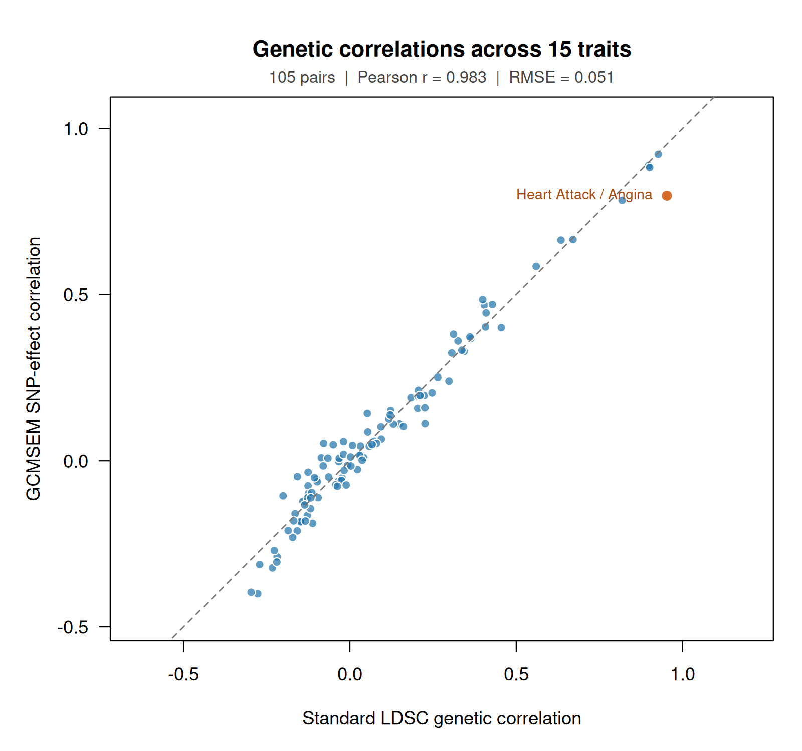

# GCMSEM — Genomic Comoment SEM

GCMSEM estimates covariance, co-skewness and fourth cumulants of joint SNP effects from GWAS summary statistics, then fits structural equation models to those quantities. Its R interface returns moment matrices, fitted models, parameter tables and logs directly to your R session. The standalone SEM engine has no dependency on MCMSEM or lavaan; a Python engine handles summary-statistic harmonization and moment estimation.

**R package version 0.2.0 adds an interactive R workflow.** The Python engine remains at version 0.1.0. The software includes input validation, reproducible tests, logs and numerical diagnostics. Higher-order inference remains under validation; interval coverage and causal identification depend on the statistical model and data. See the [executed validation](docs/validation.md) and [statistical assumptions](docs/statistical-assumptions.md).

## What is included

* Signed LD-power score construction from PLINK reference genotypes or signed LD blocks, disjoint MAF strata, and separate reference/source and regression/tag sets.
* Allele harmonization, explicit effect-scale conversion, estimated cross-trait sampling-error covariance, and Gaussian sampling-noise correction without sample splitting.
* Means and cumulants through order four for arbitrary trait counts, selected higher-order tuples, trait covariance/correlation matrices, and their joint genomic jackknife sampling covariance.
* Standalone R model syntax for paths, factors, covariance, third and fourth source cumulants, fixed parameters and equality labels.
* Unconstrained DWLS fitting with exact derivatives, multiple starts, full-covariance sandwich SEs, prominent Heywood warnings, and separate checks for identification, source-moment admissibility and convergence. Source-moment feasibility penalties are optional.

## Install

Use Python 3.10 or newer, R 4.1 or newer, and a C++ compiler. Run these commands in a terminal:

```bash
git clone https://github.com/MichelNivard/GCMSEM.git
cd GCMSEM
python3 -m venv .venv
source .venv/bin/activate
python -m pip install .
Rscript -e 'install.packages("jsonlite", repos="https://cloud.r-project.org")'
R CMD INSTALL .
```

The Python installation includes NumPy and SciPy. The R-to-Python bridge, `estimate_moments()`, requires `jsonlite`. Start R from this terminal with the Python environment still activated. You can also pass its executable explicitly, for example `python = ".venv/bin/python"`. R-only fitting from existing moment objects uses R's standard libraries and the compiled kernel. GWASBrewer is used by the separate simulation validation.

## Run a complete small example

This example runs immediately after installation and generates its own inputs. From the repository directory, create three synthetic GWAS tables and their signed LD-power scores:

```bash
python examples/make_toy_inputs.py --out toy
gcmsem score --manifest toy/ld_manifest.tsv --out toy/scores.npz
```

`toy/A.tsv`, `toy/B.tsv` and `toy/C.tsv` contain one SNP per row, with `SNP`, `A1`, `A2`, `BETA`, `SE` and `EAF` columns. `toy/sumstats.tsv` names those files and declares per-allele effects. `toy/scores.npz` holds their LD-power scores; `toy/noise.tsv` contains the known cross-trait sampling-noise intercepts for this simulation.

Now start R in the same directory:

```r
library(GCMSEM)

moments <- estimate_moments(
  "toy/sumstats.tsv",
  scores = "toy/scores.npz",
  noise_intercept = "toy/noise.tsv",
  n_blocks = 80
)
moments

scaled <- standardize_moments(moments)
model <- gcmsem_model('
  B ~ ab*A
  C ~ bc*B
', observed = c("A", "B", "C"), gaussian_observed = FALSE)

fit <- gcmsem(model, scaled, n_starts = 8, seed = 20261103)
summary(fit)
parameter_estimates(fit)

moments$R                 # Complete 3 x 3 genetic-correlation matrix
coef(fit)[c("ab", "bc")]  # Named path estimates
vcov(fit)                 # Parameter sampling covariance
tail(fit$log, 3)          # Retained estimation log
```

The moment object prints:

```text
GCMSEM moments
Traits: A, B, C
SNPs: 3,769
Cumulants: 34 (order 1: 3, order 2: 6, order 3: 10, order 4: 15)
Sampling covariance V: 34 x 34   Jackknife groups: 80

Genetic correlations ($R)
       A      B      C
A 1.0000 0.4095 0.0421
B 0.4095 1.0000 0.3293
C 0.0421 0.3293 1.0000
```

The fitted paths are approximately `ab = 0.3367` and `bc = 0.3001`; `summary(fit)` displays their formal SEs alongside all source-moment parameters and model diagnostics.

`standardize_moments()` divides each trait's SNP effects by its estimated marginal SD and transforms every cumulant and its sampling covariance consistently. The scaling constants are held fixed for fitting and SE calculation; `scaled$scaling$scale` records them. Path estimates from this fit are on that SNP-effect-SD scale.

The toy input has three traits, unequal synthetic LD block sizes, non-Gaussian effects and correlated sampling error. For an ordinary GWAS analysis, omit `noise_intercept` to estimate it from LD regressions. The [GWASBrewer validation](validation/) separately uses the real HapMap3 chromosome 19 LD pattern and varying block lengths.

For real data, follow the [height/weight and BMI/SBP tutorial](tutorials/Causal-examples.md) or the [15-trait LDSC comparison](tutorials/Fifteen-trait-correlations.md). They explain each input file, show executable R code and include the resulting console output. The correlation tutorial reads standard LDSC estimates into R and draws this comparison:



The empirical numerical archives are stored separately from GitHub. Their public release is pending; see the [data availability and installation page](tutorials/README.md). The small example above requires no empirical downloads.

For real GWAS, use an appropriate signed LD reference and an explicit sumstats manifest:

| trait | path | effect_scale |
|---|---|---|
| Height | height.tsv.gz | allele |
| Weight | weight.tsv.gz | allele |
| BMI | bmi.tsv.gz | allele |

Save this as a tab-separated file. Each GWAS table requires `SNP`, `A1`, `A2`, `BETA`, `SE`; optional `EAF` means frequency of `A1`. The manifest scale is `allele` or `genotype_standardized`. The phenotype's original units are preserved. Do not supply odds ratios as `BETA`; use the underlying log-odds coefficient where appropriate. Binary GWAS are not automatically transformed to liability scale.

See [score construction](docs/scores.md) for reference formats and finite-reference corrections, and the [moment estimator guide](docs/moment-estimator.md) for GWAS inputs, equations, selection of higher moments, and output files. The harmonizer uses a common complete set of tags across traits; it does not combine pair-specific SNP subsets into a joint covariance. It keeps zero-effect SNPs and applies no association-significance filter.

## Specify a model in R

`gaussian_observed = FALSE` frees the marginal third and fourth cumulants of the **observed variables' disturbances**. `gaussian_latent` controls latent disturbances separately. These switches do not force marginal observed variables to be Gaussian when they receive non-Gaussian inputs. `orders = 2:3` in `gcmsem()` selects which observed moments enter the fitting objective; it is a different operation.

Paths, loadings and covariances use familiar SEM notation. Higher cumulants use an explicit tuple of variables, with parameter labels kept outside that tuple:

| Syntax | Meaning |
|---|---|
| `y ~ b*x` | Path from x to y, labeled b |
| `f =~ a*x + a*y` | Factor with equal direct loadings a |
| `f ~~ 1*f` | Fixed factor disturbance variance |
| `x ~~ y` | Disturbance covariance |
| `k3(x, x, y) = free("s")` | Third cumulant of x,x,y disturbances, labeled s |
| `k3(x, y, y) = free("t")` | Third cumulant of x,y,y disturbances, labeled t |
| `k4(x, x, y, y) = free()` | Free fourth cumulant of x,x,y,y disturbances |
| `k3(f, f, f) = free("skew_f")` | Free factor third cumulant |
| `k4(f, f, f, f) = 0` | Fix the factor fourth cumulant to its Gaussian value |

Every argument inside `k3(...)` or `k4(...)` is a variable. The quoted name inside `free("...")` is a parameter label, even when it has the same spelling as a variable. For example, `k3(x, x, y) = free("y")` contains two x indices and one y index; its parameter is labeled y. Reusing a label imposes equality. `free()` or a bare `k3(x, x, y)` creates an unlabeled free parameter; a numeric right-hand side fixes the cumulant.

Repeated names specify repeated tensor indices; fourth-order parameters are **excess cumulants**, so Gaussian means zero. Tuple syntax also represents cross-cumulants involving three or four different traits. Higher cross-source cumulants not declared in syntax are zero. The old directional punctuation aliases have been retired rather than assigned a new meaning. See the [model syntax guide](docs/model-syntax.md) for defaults and migration guidance. This is a documented subset and extension of lavaan-like syntax, not a drop-in replacement for every lavaan feature. Means are estimated by Python but are not currently fitted as an R mean structure.

## Work with results in R

`estimate_moments()` and `gcmsem()` return R objects and create no result files by default. Typing an object prints a compact overview. `summary(fit)` displays its diagnostics and parameter table; assigning `s <- summary(fit)` keeps a structured summary without printing. Use `as.data.frame()` to extract the moment or parameter table.

| R expression | Contents |
|---|---|
| `moments$moments` | Data frame of cumulant keys, orders, estimates and jackknife SEs |
| `moments$S`, `moments$S_SE` | SNP-effect covariance and SE matrices for all traits |
| `moments$R`, `moments$R_SE` | Genetic correlations and delta-method SEs using the full sampling covariance |
| `moments$V` | Full joint sampling covariance of the cumulant estimates |
| `moments$jackknife` | Matrix of genomic deletion estimates |
| `moments$metadata`, `moments$log` | Provenance, QC, settings and the Python estimation log |
| `parameter_estimates(fit)` | Numeric parameter estimates, formal SEs and inference-status labels |
| `coef(fit)`, `vcov(fit)` | Named coefficient vector and parameter sampling covariance |
| `fit$diagnostics`, `fit$log` | Convergence, identification, source-moment checks and fitting log |

`summary(moments)` shows the covariance and correlation matrices with SEs. Console previews show at most six traits; `print(moments, max.traits = Inf)` shows all traits. Every matrix in the object is complete.

Save the entire object with ordinary R serialization, or request tabular files explicitly:

```r
saveRDS(fit, "toy/fit.rds")
restored <- readRDS("toy/fit.rds")

export_gcmsem(moments, "toy/exported-moments")
export_gcmsem(fit, "toy/exported-fit")
reloaded <- read_moments("toy/exported-moments")

# This option still returns the fitted R object.
fit_with_files <- gcmsem(
  model, scaled, n_starts = 8, seed = 20261103,
  write.to.tsv = TRUE, out = "toy/another-fit"
)
```

Exports refuse existing files unless `overwrite = TRUE`. `estimate_moments()` accepts the same `write.to.tsv` and `out` arguments. `log_file` explicitly writes a fit log, while `verbose = TRUE` displays progress in the console. Logs remain available in the returned objects.

The Python CLI remains available for terminal workflows and writes versioned moment bundles; `read_moments(prefix)` loads them into the same R object format. [The estimator guide](docs/moment-estimator.md) describes each bundle file. Multiple MAF strata produce conditional objects in `moments$conditional`. Pooling uses raw-moment mixture identities. Source counts remain fixed when tag rows are filtered or deleted. Jackknife groups preserve whole LD blocks and account for unequal deletion sizes.

## Uncertainty

R minimizes a diagonal-weighted discrepancy. Its sandwich SEs use the entire supplied sampling covariance, without dividing by sample size again. `Q` is reported as an **uncalibrated discrepancy**, not a WLSMV or chi-square test.

**The default retains Heywood cases.** Free disturbance variances and higher cumulants are not clipped to the admissible region, and the multistart search does not prefer a worse fit merely because its source moments are admissible. Negative variances or impossible higher source moments generate prominent warnings and diagnostic flags; point estimates and computable formal sandwich SEs remain available. This preserves the estimator's sampling variability across replications. Inadmissibility is distinct from nonconvergence or nonidentification, for which an ordinary numerical SE may not be available. Report all statuses when aggregating studies; silently discarding flagged fits can introduce selection bias.

`feasibility="penalty"` is an explicitly requested alternative estimator. It can change sampling bias and the distribution of estimates, particularly near a boundary. Neither formal SEs nor an admissible solution resolve model-selection uncertainty, calibrated interval coverage, or equivalent causal structures.

## Scaling and computation

The count of all symmetric moments through order four is $\binom{N+4}{4}-1$. Python computes higher-order responses one tuple at a time, supports selecting tuples, and checks expected memory requirements. The full joint sampling covariance still needs quadratic storage in the number of selected moments. Its rank is at most $B-1$ for $B$ deletion groups; DWLS does not require inverting that matrix.

For the path matrix $A$, the R engine uses

```math
T=(I-A)^{-1},\qquad \mathrm{d}T=T\,(\mathrm{d}A)\,T.
```

It then applies product rules to sparse source cumulants. Fitting uses these exact gradients with `nlminb`. This is an exact specialized derivative engine, not a general torch/autodiff graph. Native tensor contraction accelerates the repeated calculation, while the R implementation provides an independent reference path. The [RAM-style engine explanation](docs/engine.md) describes how this generalizes to user-defined models. Large-scale performance and calibration should be assessed for the requested trait/moment set.

## Development and provenance

```bash
python -m pip install '.[test]'
python -m pytest tests/python -q
R CMD build . --no-build-vignettes --no-manual
R CMD check GCMSEM_0.2.0.tar.gz --no-manual --no-vignettes
```

GitHub Actions runs Python tests and R package checks. See [contributing](CONTRIBUTING.md), [references](docs/references.md), [statistical assumptions](docs/statistical-assumptions.md), and [validation](docs/validation.md). All empirical reference and GWAS datasets retain their own licenses and must be obtained separately.
