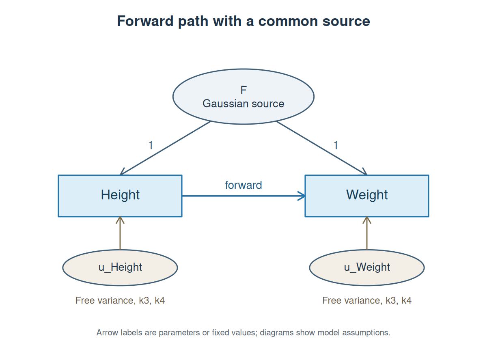
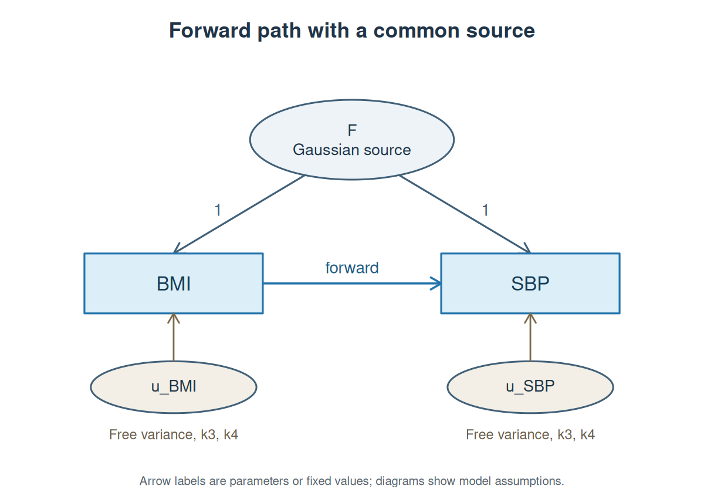
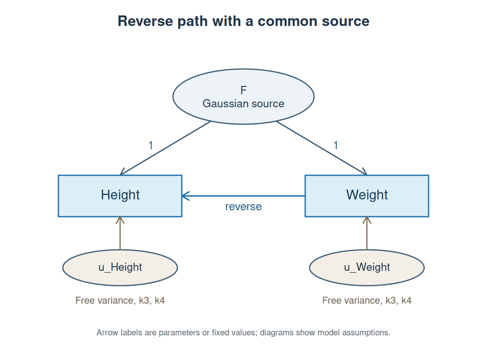
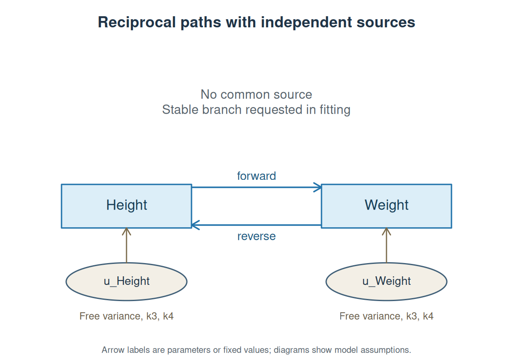
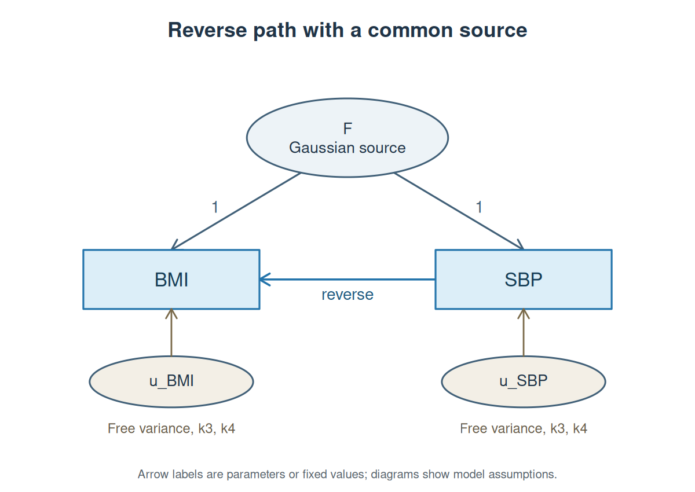
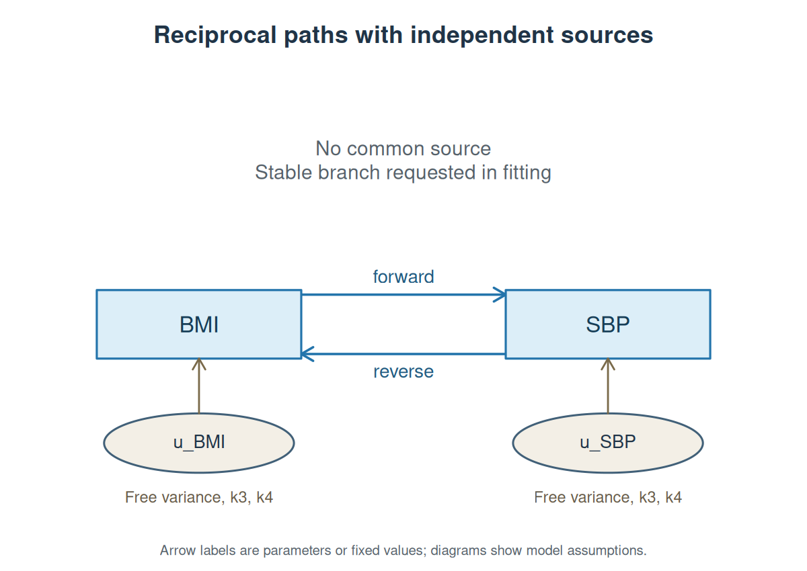

# Height/weight and BMI/blood-pressure SEMs in R

This tutorial starts with SNP-level GWAS summary statistics, estimates their genetic cumulants, and fits an SEM in R. You will draw and fit three candidate models for height/weight, inspect how well each reproduces the estimated moments, and repeat the analysis for BMI and systolic blood pressure (SBP). We assess fit before interpreting any path. The height/weight analysis illustrates why convergence alone is insufficient: all three candidate models show lack of fit under the approximate Q diagnostic introduced below.

The examples use Neale Lab UK Biobank round-2 GWAS results:

| R trait name | Source phenotype | Units |
|---|---|---|
| `Height` | `50_irnt` | Inverse-normal-transformed height |
| `Weight` | `21002_irnt` | Inverse-normal-transformed weight |
| `BMI` | `21001_raw` | kg/m² |
| `SBP` | `4080_raw` | mmHg |

## 1. Install the software and obtain the files

Follow the [installation commands](README.md#install), then run the terminal commands below from the `GCMSEM` repository directory. Keep the Python environment activated when starting R so that `estimate_moments()` can find the installed Python engine.

Download the precomputed scores and four prepared GWAS tables from the [public Zenodo release](https://zenodo.org/records/23977299):

```bash
python tutorials/download_data.py --asset scores --asset causal --out tutorial-data
```

This verifies each archive's size and SHA-256, then extracts it into `tutorial-data/`. If you downloaded the ZIP files manually, use:

```bash
mkdir -p tutorial-data
unzip gcmsem-scores-v1.zip -d tutorial-data
unzip gcmsem-causal-v1.zip -d tutorial-data
```

Here are the files used in this tutorial:

| File under `tutorial-data/` | Contents |
|---|---|
| `scores/eur_hm3.scores.npz` | Precomputed signed LD-power scores and reference metadata for 1,074,062 HapMap3 regression SNPs; orders 1–4, five MAF strata and 1 Mb LD windows |
| `sumstats/50_irnt.tsv.gz` | Prepared height summary statistics |
| `sumstats/21002_irnt.tsv.gz` | Prepared weight summary statistics |
| `sumstats/21001_raw.tsv.gz` | Prepared BMI summary statistics |
| `sumstats/4080_raw.tsv.gz` | Prepared SBP summary statistics |
| `provenance/` | Original source URLs, phenotype definitions, checksums and preparation records |

The compressed summary-statistic files are ordinary tab-separated text. The `.npz` score file is read directly by the estimator. The [scores page](Data-and-scores.md) explains how these scores were constructed.

If you want to start from the original GWAS downloads, the [final section](#9-start-from-the-original-neale-lab-downloads) gives the exact `wget` and preparation commands.

## 2. Inspect the height file in R

Start R in the repository directory:

```r
library(GCMSEM)

height_head <- read.delim(
  gzfile("tutorial-data/sumstats/50_irnt.tsv.gz"),
  nrows = 3
)
print(height_head, digits = 4, row.names = FALSE)
```

The first three records are:

```text
        SNP A1 A2       BETA       SE      N CHR     BP  REF_AF
  rs3131969  A  G -0.0009732 0.001167 360388   1 754182 0.12823
 rs12562034  A  G  0.0011891 0.001097 360388   1 768448 0.09245
  rs4040617  G  A -0.0009679 0.001128 360388   1 779322 0.11829
```

Each row describes one SNP:

| Column | Meaning in the prepared files |
|---|---|
| `SNP` | Variant rs identifier, used to match the score file |
| `A1`, `A2` | Effect allele and other allele; effects have been aligned to the score reference |
| `BETA`, `SE` | Association estimate and standard error per SD of genotype dosage |
| `N` | GWAS sample size for that SNP |
| `CHR`, `BP` | Chromosome and GRCh37 base-pair coordinate |
| `REF_AF` | Reference-panel frequency of `A1`; the original GWAS effect-allele frequency is unavailable in these prepared files |

The phenotype units remain those in the first table. For example, standardizing genotype dosage leaves the BMI outcome in kg/m².

## 3. Estimate the height/weight moments

A manifest is a small R data frame: one row per trait, with its name, input file and effect scale. The trait names become the variable names in your SEM.

```r
hw_files <- data.frame(
  trait = c("Height", "Weight"),
  path = c("tutorial-data/sumstats/50_irnt.tsv.gz",
           "tutorial-data/sumstats/21002_irnt.tsv.gz"),
  effect_scale = "genotype_standardized"
)

hw_moments <- estimate_moments(
  hw_files,
  scores = "tutorial-data/scores/eur_hm3.scores.npz",
  max_order = 4,
  n_blocks = 200
)

hw_moments
```

The R reference run took about three minutes. It matches alleles, estimates cumulants through order four, and calculates their joint sampling covariance using chromosome-respecting jackknife groups. The returned R object prints:

```text
GCMSEM moments
Traits: Height, Weight
SNPs: 1,074,059
Cumulants: 14 (order 1: 2, order 2: 3, order 3: 4, order 4: 5)
Sampling covariance V: 14 x 14   Jackknife groups: 200

Genetic correlations ($R)
       Height Weight
Height  1.000  0.472
Weight  0.472  1.000
```

The object keeps the quantities you need for analysis:

```r
hw_moments$S                 # SNP-effect covariance matrix
hw_moments$R                 # Genetic correlation matrix
hw_moments$R_SE              # Correlation SEs from the full sampling covariance
head(as.data.frame(hw_moments))  # Individual cumulants and their SEs
V <- vcov(hw_moments)        # Joint covariance of the 14 estimated cumulants
```

The 14 cumulants comprise two means, three second-order terms, four third-order terms and five fourth-order terms. This SEM uses the 12 centered terms of orders 2–4. Order-four terms are excess cumulants: they equal zero for Gaussian sources.

## 4. Specify and fit the height-to-weight model

First put both SNP-effect distributions on a convenient scale:

```r
hw_scaled <- standardize_moments(hw_moments)
hw_scaled$scaling$scale
```

`standardize_moments()` divides each trait's effects by its estimated SNP-effect SD and transforms the entire sampling covariance consistently. These scale constants are held fixed during fitting and SE calculations. In this example the common source has equal direct loadings **on this SNP-effect-SD scale**; choosing another scale changes that model restriction.

Now define the model as an R string:

```r
height_to_weight <- '
  Weight ~ forward*Height

  F =~ 1*Height + 1*Weight
  F ~~ shared_variance*F
  k3(F, F, F) = 0
  k4(F, F, F, F) = 0

  Height ~~ variance_x*Height
  Weight ~~ variance_y*Weight
  k3(Height, Height, Height) = free("skew_x")
  k3(Weight, Weight, Weight) = free("skew_y")
  k4(Height, Height, Height, Height) = free("excess_x")
  k4(Weight, Weight, Weight, Weight) = free("excess_y")
'

hw_model <- gcmsem_model(
  height_to_weight,
  observed = c("Height", "Weight"),
  gaussian_observed = FALSE,
  gaussian_latent = TRUE
)
```

Draw the model from the R specification:

```r
source("tutorials/plot_models.R")
plot_causal_model(hw_model, "Height to weight with a common source")
```



Rectangles are the two traits' SNP-effect variables. The latent source `F` contributes to both. The trait-specific sources `u_Height` and `u_Weight` have free variances, third cumulants and fourth cumulants. Their cross-source cumulants are fixed to zero. The arrow labeled `forward` carries height-associated genetic effects into weight; the two arrows labeled `1` impose equal direct common-source loadings on the chosen scale. Labels show the specification, not estimated effects.

Read the syntax line by line:

- `Weight ~ forward*Height` estimates a directed path named `forward`.
- `F =~ 1*Height + 1*Weight` defines a common source with both direct loadings fixed to one.
- `F ~~ shared_variance*F` estimates its variance freely, including negative values.
- `k3(F, F, F) = 0` and `k4(F, F, F, F) = 0` give this source Gaussian third- and fourth-order cumulants.
- `Height ~~ variance_x*Height` and its weight counterpart estimate trait-specific source variances.
- `free("skew_x")` and `free("excess_x")` name free third- and fourth-order source cumulants. Every variable in a cumulant is written explicitly inside the tuple.

Fit the model with 32 starting points and retain the result in `hw_fit`:

```r
fit_control <- list(iter.max = 5000, eval.max = 10000, rel.tol = 1e-11)

hw_fit <- gcmsem(
  hw_model, hw_scaled,
  orders = 2:4,
  n_starts = 32,
  seed = 20261105,
  feasibility = "check",
  control = fit_control
)

hw_fit
fit_measures(hw_fit)
```

The fit returns an R object and prints a prominent warning because the common-source variance is negative. Its overview is:

```text
GCMSEM DWLS fit
Observed traits: Height, Weight
Moments: 12   Free parameters: 8   Jacobian rank: 8/8
Converged: yes   Uncalibrated Q: 1.797
Q approximate SE: 1.257   Approximate null mean (SD): 0.2811 (0.31)
Q moment-matched p (approximate): 0.003311   Status: formal_only_flagged
Formal sandwich SEs: available   Inference checks: flagged
*** HEYWOOD CASE: source moment checks failed ***
Negative source variance: F
Estimates and available formal SEs retained.
Flags: source moment feasibility checks failed
```

`Q` measures the weighted mismatch between observed and predicted moments. A raw Q of 1.797 may look small, but its approximate null mean here is only 0.2811. The correlations among moment errors and the moments absorbed by fitted parameters determine that reference. The approximate tail probability is 0.0033, and the estimated common-source variance is inadmissible. We therefore keep this fitted object for diagnosis and do not interpret its path as a supported effect.

## 5. Inspect the residuals and keep the result in R

```r
hw_fit$diagnostics
hw_q <- fit_measures(hw_fit)

hw_residuals <- data.frame(
  moment = names(hw_fit$observed),
  observed = unname(hw_fit$observed),
  predicted = unname(fitted(hw_fit)),
  residual_in_SEs = unname(hw_fit$residuals / sqrt(diag(hw_fit$V)))
)
hw_residuals[order(-abs(hw_residuals$residual_in_SEs)), ]
```

Each residual is a moment the model needs to explain. Dividing by its SE makes different orders easier to inspect. The residuals are correlated, so this column is a descriptive check rather than a collection of independent tests.

`parameter_estimates(hw_fit)` and `vcov(hw_fit)` retain the full estimates and formal parameter covariance for auditing or simulation summaries, including Heywood cases. We omit the path-effect table here because the model does not adequately reproduce these moments. See [Working with R results](R-results.md) for the complete extractor and saving interface.

## 6. Estimate moments and specify the BMI-to-SBP model

Now repeat the workflow for BMI and systolic blood pressure. These input files retain physical phenotype units: kg/m² and mmHg.

```r
bs_files <- data.frame(
  trait = c("BMI", "SBP"),
  path = c("tutorial-data/sumstats/21001_raw.tsv.gz",
           "tutorial-data/sumstats/4080_raw.tsv.gz"),
  effect_scale = "genotype_standardized"
)
bs_moments <- estimate_moments(
  bs_files,
  scores = "tutorial-data/scores/eur_hm3.scores.npz",
  max_order = 4, n_blocks = 200
)
bs_scaled <- standardize_moments(bs_moments)

bmi_to_sbp <- '
  SBP ~ forward*BMI
  F =~ 1*BMI + 1*SBP
  F ~~ shared_variance*F
  k3(F, F, F) = 0
  k4(F, F, F, F) = 0
  BMI ~~ variance_x*BMI
  SBP ~~ variance_y*SBP
  k3(BMI, BMI, BMI) = free("skew_x")
  k3(SBP, SBP, SBP) = free("skew_y")
  k4(BMI, BMI, BMI, BMI) = free("excess_x")
  k4(SBP, SBP, SBP, SBP) = free("excess_y")
'
bs_model <- gcmsem_model(
  bmi_to_sbp, observed = c("BMI", "SBP"),
  gaussian_observed = FALSE, gaussian_latent = TRUE
)
plot_causal_model(bs_model, "BMI to SBP with a common source")
bs_fit <- gcmsem(
  bs_model, bs_scaled, n_starts = 32, seed = 20261105,
  feasibility = "check", control = fit_control
)
bs_fit
```



The moment analysis retains 1,074,057 SNPs and returns 14 cumulants and a 14 × 14 `V`. The SEM uses the same 12 centered moments as the height/weight example. It converges with Q = 5.349, approximate Q SE = 4.848 and approximate tail probability 0.0770. The common-source variance is again negative. Its moment discrepancy is less concerning than the height/weight model's relative to its own reference, but its source-distribution warning remains. We keep both diagnostics visible and examine alternative structures next.

## 7. Compare forward, reverse and reciprocal models

There are three substantive hypotheses for each pair:

| Model | Directed paths | Source assumptions |
|---|---|---|
| Forward with common source | First trait influences the second | A Gaussian common source has equal direct loadings on the standardized SNP-effect scale; trait-specific sources have free higher cumulants. |
| Reverse with common source | Second trait influences the first | The same common-source and trait-specific restrictions are retained. |
| Reciprocal sensitivity model | Both traits influence each other | Trait-specific sources are independent, with free higher cumulants. There is no common source. A stable solution branch is requested. |

The reciprocal model changes the confounding assumption as well as the paths. It has the same eight free parameters here: it replaces the common-source variance with a second directed path. It is a separate sensitivity model, not a generalization containing both directional models.

### Reverse height/weight model

Replace the directed path while retaining every other line of the forward specification:

```r
weight_to_height <- sub(
  "Weight ~ forward*Height", "Height ~ reverse*Weight",
  height_to_weight, fixed = TRUE
)
hw_reverse_model <- gcmsem_model(
  weight_to_height, observed = c("Height", "Weight"),
  gaussian_observed = FALSE, gaussian_latent = TRUE
)
plot_causal_model(hw_reverse_model, "Weight to height with a common source")
hw_reverse <- gcmsem(
  hw_reverse_model, hw_scaled, n_starts = 32, seed = 20261106,
  feasibility = "check", control = fit_control
)
```



### Reciprocal height/weight model

Specify both paths and omit `F`. The trait-specific source definitions stay explicit:

```r
hw_reciprocal_model <- gcmsem_model('
  Weight ~ forward*Height
  Height ~ reverse*Weight
  Height ~~ variance_x*Height
  Weight ~~ variance_y*Weight
  k3(Height, Height, Height) = free("skew_x")
  k3(Weight, Weight, Weight) = free("skew_y")
  k4(Height, Height, Height, Height) = free("excess_x")
  k4(Weight, Weight, Weight, Weight) = free("excess_y")
', observed = c("Height", "Weight"), gaussian_observed = FALSE)
plot_causal_model(hw_reciprocal_model, "Reciprocal height and weight")
hw_reciprocal <- gcmsem(
  hw_reciprocal_model, hw_scaled, n_starts = 32, seed = 20261107,
  stable = TRUE, feasibility = "check", control = fit_control
)
```



`stable = TRUE` selects solutions whose path matrix has spectral radius below one. For these two reciprocal paths, that requires the absolute product of the path coefficients to be below one. This is a modeling restriction. Swapping the source assignment can produce another parameterization with identical implied moments; stability selects a branch rather than proving a unique causal model.

### Reverse BMI/SBP model

```r
sbp_to_bmi <- sub(
  "SBP ~ forward*BMI", "BMI ~ reverse*SBP", bmi_to_sbp, fixed = TRUE
)
bs_reverse_model <- gcmsem_model(
  sbp_to_bmi, observed = c("BMI", "SBP"),
  gaussian_observed = FALSE, gaussian_latent = TRUE
)
plot_causal_model(bs_reverse_model, "SBP to BMI with a common source")
bs_reverse <- gcmsem(
  bs_reverse_model, bs_scaled, n_starts = 32, seed = 20261106,
  feasibility = "check", control = fit_control
)
```



### Reciprocal BMI/SBP model

```r
bs_reciprocal_model <- gcmsem_model('
  SBP ~ forward*BMI
  BMI ~ reverse*SBP
  BMI ~~ variance_x*BMI
  SBP ~~ variance_y*SBP
  k3(BMI, BMI, BMI) = free("skew_x")
  k3(SBP, SBP, SBP) = free("skew_y")
  k4(BMI, BMI, BMI, BMI) = free("excess_x")
  k4(SBP, SBP, SBP, SBP) = free("excess_y")
', observed = c("BMI", "SBP"), gaussian_observed = FALSE)
plot_causal_model(bs_reciprocal_model, "Reciprocal BMI and SBP")
bs_reciprocal <- gcmsem(
  bs_reciprocal_model, bs_scaled, n_starts = 32, seed = 20261107,
  stable = TRUE, feasibility = "check", control = fit_control
)
```



### Read the model-fit comparison

Collect the fits in an ordinary named R list, then create a data frame of their Q diagnostics:

```r
fits <- list(
  HW_forward = hw_fit, HW_reverse = hw_reverse, HW_reciprocal = hw_reciprocal,
  BS_forward = bs_fit, BS_reverse = bs_reverse, BS_reciprocal = bs_reciprocal
)
fit_table <- do.call(rbind, lapply(names(fits), function(name) {
  f <- fits[[name]]
  q <- fit_measures(f)
  data.frame(model = name,
             q[, c("Q", "Q_se", "Q_null_mean", "Q_null_95", "Q_p_approx")],
             source_checks = f$diagnostics$source_admissible)
}))
print(fit_table, digits = 4, row.names = FALSE)
```

```text
        model      Q   Q_se Q_null_mean Q_null_95 Q_p_approx source_checks
   HW_forward  1.797  1.257      0.2811    0.9028  3.311e-03         FALSE
   HW_reverse  5.456  4.881      1.2474    4.2299  2.354e-02         FALSE
HW_reciprocal  4.286  2.013      0.3210    1.0179  7.096e-06          TRUE
   BS_forward  5.349  4.848      2.1743    6.1987  7.704e-02         FALSE
   BS_reverse 16.389 10.801      3.9340   10.5448  7.420e-03          TRUE
BS_reciprocal  4.193  3.037      1.8199    4.8104  7.761e-02          TRUE
```

All six models converge with local Jacobian rank 8/8. They each use 12 moments and eight free parameters. Compare the three models **within** each pair; the two trait pairs have different moments and weights.

For height/weight, every candidate exceeds its approximate 95th-percentile Q reference. The forward model has the smallest raw discrepancy, but it still shows lack of fit and a Heywood case. This analysis does not support reporting a height/weight causal path from these specifications. The next scientific step would be to examine source restrictions, conditional MAF-stratum moments and possible misspecification.

For BMI/SBP, the reverse model has a substantially larger discrepancy and exceeds its reference threshold. We do not interpret its path estimate. The forward and reciprocal models fall below their respective approximate thresholds. The forward model retains a negative common-source variance, while the reciprocal model passes the implemented source-moment checks. We use the reciprocal fit to illustrate conditional parameter interpretation below, while retaining the other fits and their diagnostics in `fits`.

These probabilities are **exploratory approximations**, not a validated higher-order GWAS fit test. They use the full `V`, remove variation absorbed by fitted parameters, and match the first two moments of a local Gaussian quadratic form. `Q_se` is a rough sampling SD incorporating estimated misfit; it is not a threshold for accepting a model. The models share moment estimates, so separate Q SEs do not give the SE of a Q difference. The forward/reverse comparison is nonnested, and a difference in Q is not a causal-direction p-value. [Working with R results](R-results.md#assess-model-fit-before-interpreting-paths) gives the derivation and limitations.

### Interpret paths only after the fit checks

Extract the reciprocal BMI/SBP paths and transform them from standardized SNP-effect units to the original phenotype scale:

```r
paths <- parameter_estimates(bs_reciprocal)
paths <- paths[paths$parameter %in% c("forward", "reverse"), ]
from <- ifelse(paths$parameter == "forward", "BMI", "SBP")
to <- ifelse(paths$parameter == "forward", "SBP", "BMI")
ratio <- unname(bs_scaled$scaling$scale[to] / bs_scaled$scaling$scale[from])
interpreted <- data.frame(
  from, to,
  estimate = paths$estimate * ratio,
  formal_se = paths$se * ratio
)
print(interpreted, digits = 6, row.names = FALSE)
```

```text
 from  to   estimate formal_se
  BMI SBP  0.7732663 0.1483209
  SBP BMI -0.0428784 0.0131532
```

The first path is in mmHg per kg/m²; the second is in kg/m² per mmHg. Both estimates condition on the reciprocal, independent-source model, the fixed scaling constants and the stable solution branch. Their interpretation as causal effects requires those assumptions to be credible. Passing this approximate fit check does not establish them, and selecting a model before reporting its paths adds uncertainty not included in these formal SEs.

The complete [height/weight](height_weight.R) and [BMI/SBP](bmi_sbp.R) scripts perform the same fits and return all results. For example, `hw <- height_weight_example(moments = hw_moments)` reuses your moments. Their `paths` tables retain every model for auditing; the tutorial's interpretation follows the fit assessment above.

## 8. Keep logs or save results

```r
cat(tail(hw_moments$log, 8), sep = "\n")
cat(tail(hw_fit$log, 8), sep = "\n")
saveRDS(fits, "candidate-models.rds")
saveRDS(list(height_weight = hw_moments, bmi_sbp = bs_moments), "moments.rds")
```

Logs record QC, estimation settings, optimizer starts, Q, its approximate uncertainty and model diagnostics. `verbose = TRUE` in `estimate_moments()` prints the engine log after estimation; in `gcmsem()` it displays the fitting log as optimization proceeds.

If you need tables, export explicitly:

```r
export_gcmsem(hw_moments, "tutorial-results/height-weight-moments")
export_gcmsem(bs_reciprocal, "tutorial-results/bmi-sbp-reciprocal")
```

The fit export includes `.fit_measures.tsv`. Both estimation and fitting also accept `write.to.tsv = TRUE, out = "path/prefix"` and still return R objects. Existing files are replaced only with `overwrite = TRUE`.

## 9. Start from the original Neale Lab downloads

This route uses the public source files directly. You need the score file from step 1 and about 2.2 GB for the four compressed downloads. The following terminal commands save each original file under `raw-gwas/`:

```bash
mkdir -p raw-gwas prepared-gwas

wget -O raw-gwas/height.tsv.bgz \
  https://broad-ukb-sumstats-us-east-1.s3.amazonaws.com/round2/additive-tsvs/50_irnt.gwas.imputed_v3.both_sexes.tsv.bgz
wget -O raw-gwas/weight.tsv.bgz \
  https://broad-ukb-sumstats-us-east-1.s3.amazonaws.com/round2/additive-tsvs/21002_irnt.gwas.imputed_v3.both_sexes.tsv.bgz
wget -O raw-gwas/bmi.tsv.bgz \
  https://broad-ukb-sumstats-us-east-1.s3.amazonaws.com/round2/additive-tsvs/21001_raw.gwas.imputed_v3.both_sexes.tsv.bgz
wget -O raw-gwas/sbp.tsv.bgz \
  https://broad-ukb-sumstats-us-east-1.s3.amazonaws.com/round2/additive-tsvs/4080_raw.gwas.imputed_v3.both_sexes.tsv.bgz
```

The source files identify variants as `chromosome:position:REF:ALT`. They include `beta`, `se`, `n_complete_samples`, `minor_allele`, `minor_AF` and a low-confidence flag. The [Neale Lab export pipeline](https://github.com/Nealelab/UK_Biobank_GWAS/blob/master/0.1/27.export_ldsc_sumstats.py) defines `ALT` as the effect allele. The adapter below retains that orientation, calculates its GWAS allele frequency from `minor_allele` and `minor_AF`, removes low-confidence records, and matches chromosome, position and alleles to the HapMap3 score metadata:

```bash
python tutorials/prepare_neale_sumstats.py \
  --sumstats raw-gwas/height.tsv.bgz \
  --scores tutorial-data/scores/eur_hm3.scores.npz \
  --out prepared-gwas/height.tsv.gz

python tutorials/prepare_neale_sumstats.py \
  --sumstats raw-gwas/weight.tsv.bgz \
  --scores tutorial-data/scores/eur_hm3.scores.npz \
  --out prepared-gwas/weight.tsv.gz

python tutorials/prepare_neale_sumstats.py \
  --sumstats raw-gwas/bmi.tsv.bgz \
  --scores tutorial-data/scores/eur_hm3.scores.npz \
  --out prepared-gwas/bmi.tsv.gz

python tutorials/prepare_neale_sumstats.py \
  --sumstats raw-gwas/sbp.tsv.bgz \
  --scores tutorial-data/scores/eur_hm3.scores.npz \
  --out prepared-gwas/sbp.tsv.gz
```

The adapter writes `SNP`, `A1`, `A2`, `BETA`, `SE`, `N`, `EAF`, `CHR` and `BP` columns, plus adjacent `.json` provenance and `.log` files. The height and weight conversions each read 13,791,467 rows and retained 1,074,062 score-tag SNPs in about 92 seconds in the reference run.

Inspect the converted height file in R:

```r
original_head <- read.delim(gzfile("prepared-gwas/height.tsv.gz"), nrows = 3)
print(original_head, digits = 4, row.names = FALSE)
```

```text
        SNP A1 A2      BETA       SE      N    EAF CHR     BP
  rs3131969  G  A  0.002058 0.002467 360388 0.8705   1 754182
 rs12562034  A  G  0.002903 0.002679 360388 0.1060   1 768448
  rs4040617  G  A -0.002119 0.002471 360388 0.1278   1 779322
```

Here `BETA` and `SE` are per allele, so declare **`effect_scale = "allele"`** in the R manifest. `estimate_moments()` performs the genotype-scale conversion and reference-allele harmonization.

```r
hw_original_files <- data.frame(
  trait = c("Height", "Weight"),
  path = c("prepared-gwas/height.tsv.gz", "prepared-gwas/weight.tsv.gz"),
  effect_scale = "allele"
)

source("tutorials/height_weight.R")
hw_original <- height_weight_example(sumstats = hw_original_files)
fit_measures(hw_original$forward)

bs_original_files <- data.frame(
  trait = c("BMI", "SBP"),
  path = c("prepared-gwas/bmi.tsv.gz", "prepared-gwas/sbp.tsv.gz"),
  effect_scale = "allele"
)
source("tutorials/bmi_sbp.R")
bs_original <- bmi_sbp_example(sumstats = bs_original_files)
fit_measures(bs_original$forward)
```

The executed original-source height/weight analysis took about three minutes for estimation and all three SEM fits. It retained 1,074,059 common SNPs after excluding three ambiguous palindromic SNPs, with zero allele or frequency mismatches. Every estimated cumulant, the full sampling covariance `V`, and the correlation matrix `R` were numerically identical to the prepared-file run above. All three fits reproduced the displayed path estimates and SEs. The adapter preserves original GWAS allele frequencies; the returned object's logs and QC metadata record how each SNP was handled.
