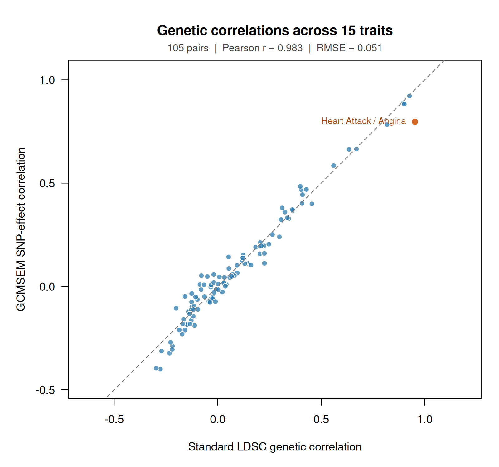

# Genetic correlations for 15 traits in R

This tutorial creates a 15 × 15 genetic-correlation matrix, reads the standard LDSC results into R, and plots the 105 distinct trait pairs. You will keep the GCMSEM moments, both correlation matrices, the pairwise results, and the comparison statistics as R objects.

The worked output below uses the completed GCMSEM analysis and **original, unmodified bulik/ldsc 1.0.1 with its published reference and weighting scores**. The last two sections show how to rerun each analysis from the summary statistics.

## 1. Install the software

Run these commands in a terminal. They download the source code, install the Python engine, and install the R package:

```bash
git clone https://github.com/MichelNivard/GCMSEM.git
cd GCMSEM
python3 -m venv .venv
. .venv/bin/activate
python -m pip install .
Rscript -e 'install.packages("jsonlite", repos="https://cloud.r-project.org")'
R CMD INSTALL .
```

Use Python 3.10 or newer for GCMSEM. Start R from this `GCMSEM` directory, or open it as your RStudio working directory. Terminal commands below also assume this directory.

## 2. Get the scores, summary statistics, and completed results

**Data availability:** the empirical archives are prepared, but the Zenodo deposit is still unpublished. A public download URL is pending. The commands in this section work once the release is published, or immediately if you already have the three archives. The plot and printed results below were generated from the completed local analysis.

After publication, this command will download and checksum the three archives and extract them into `tutorial-data`:

```bash
python tutorials/download_data.py \
  --asset scores --asset panel --asset results --out tutorial-data
```

If you already have `gcmsem-scores-v1.zip`, `gcmsem-panel-v1.zip`, and `gcmsem-results-v1.zip`, put them in the working directory and extract them:

```bash
mkdir -p tutorial-data
unzip gcmsem-scores-v1.zip -d tutorial-data
unzip gcmsem-panel-v1.zip -d tutorial-data
unzip gcmsem-results-v1.zip -d tutorial-data
```

The numerical data live in these external archives. The repository contains the analysis scripts and the tutorial figure.

| File inside `tutorial-data` | Contents and use |
|---|---|
| `scores/eur_hm3.scores.npz` | GCMSEM's precomputed signed LD scores, SNP alleles, positions, MAF strata, and source-variant counts. The tag SNPs use the HM3 selection. |
| `sumstats/*.tsv.gz` | One compressed, allele-aligned GWAS table per trait, with `SNP`, `A1`, `A2`, `BETA`, `SE`, `N`, `CHR`, `BP`, and `REF_AF`. |
| `panel.npz` | The exact prealigned SNP-by-trait arrays used for the archived 15-trait GCMSEM run. |
| `results/correlations/gcmsem.moments.tsv` | Estimated first- and second-order cumulants, with their names and standard errors. |
| `results/correlations/gcmsem.sampling_cov.tsv` | The full sampling covariance matrix of those cumulant estimates. |
| `results/correlations/gcmsem.metadata.json` | Trait names, SNP counts, estimation settings, and provenance needed by `read_moments()`. |
| `results/standard_ldsc_verified/ldsc_standard_rg.tsv` | A symmetric 15 × 15 matrix of correlations read from stock LDSC's result summaries. |
| `results/standard_ldsc_verified/ldsc_standard_rg_se.tsv` | The corresponding LDSC standard errors. |
| `results/standard_ldsc_verified/munged/` and `fits/` | Stock LDSC munged inputs and logs for the completed runs. |

`BETA` and `SE` in these prepared GWAS files are on the genotype-standardized scale; `A1` is the effect allele and `A2` the other allele. `REF_AF` is the reference-panel frequency of `A1`. `N` is the SNP-specific sample size. The score archive contains derived scores and metadata; reference genotypes are not distributed.

The 15 input files are:

| R trait name | GWAS filename in `sumstats/` | Phenotype |
|---|---|---|
| `DrinksPerWeek` | `GSCAN_DrinksPerWeek.tsv.gz` | GSCAN drinks per week, public release excluding 23andMe |
| `VitaminD` | `30890_raw.tsv.gz` | Vitamin D |
| `SBP` | `4080_irnt.tsv.gz` | Systolic blood pressure |
| `Insomnia` | `1200.tsv.gz` | Insomnia |
| `Depression` | `20544_11.tsv.gz` | Diagnosed depression |
| `LDL` | `30780_raw.tsv.gz` | Direct LDL |
| `FEV1` | `3063_irnt.tsv.gz` | Forced expiratory volume in one second |
| `HeartAttack` | `6150_1.tsv.gz` | Heart attack |
| `Angina` | `6150_2.tsv.gz` | Angina |
| `Height` | `50_irnt.tsv.gz` | Standing height |
| `Weight` | `21002_irnt.tsv.gz` | Weight |
| `BMI` | `21001_irnt.tsv.gz` | Body mass index |
| `DBP` | `4079_irnt.tsv.gz` | Diastolic blood pressure |
| `FVC` | `3062_irnt.tsv.gz` | Forced vital capacity |
| `Waist` | `48_irnt.tsv.gz` | Waist circumference |

The numbered phenotypes come from the Neale Lab UK Biobank release. `_irnt` denotes an inverse-rank-normalized phenotype. This tutorial uses the IRNT BMI and SBP files; the causal tutorial uses their raw-phenotype files. See [Data and scores](Data-and-scores.md) for the source releases and preparation details.

## 3. Load the GCMSEM analysis into R

Run the following in R:

```r
library(GCMSEM)
options(digits = 6)
source("tutorials/correlations.R")
data_dir <- "tutorial-data"

gcmsem <- read_moments(file.path(data_dir, "results/correlations/gcmsem"))
gcmsem
```

`read_moments()` reads the three files sharing the `gcmsem` prefix and returns one R object. Printing it shows the trait and SNP counts, the number of cumulants, and a preview of the correlations:

```text
GCMSEM moments
Traits: DrinksPerWeek, VitaminD, SBP, Insomnia, Depression, LDL, FEV1, HeartAttack, Angina, Height, Weight, BMI, DBP, FVC, Waist
SNPs: 1,012,060
Cumulants: 135 (order 1: 15, order 2: 120)
Sampling covariance V: 135 x 135   Jackknife groups: 200

Genetic correlations ($R)
              DrinksPerWeek VitaminD     SBP Insomnia Depression     LDL
DrinksPerWeek        1.0000   0.0870 -0.0615   0.1024     0.0579 -0.0724
VitaminD             0.0870   1.0000  0.0483   0.0113    -0.1821 -0.1110
SBP                 -0.0615   0.0483  1.0000   0.0435    -0.0592 -0.1594
Insomnia             0.1024   0.0113  0.0435   1.0000     0.3999 -0.0156
Depression           0.0579  -0.1821 -0.0592   0.3999     1.0000  0.0463
LDL                 -0.0724  -0.1110 -0.1594  -0.0156     0.0463  1.0000
Showing 6 of 15 traits; the full matrix is in $R.
```

Extract the matrices with `$`. Each is an ordinary named R matrix:

```r
gcmsem_cov <- gcmsem$S       # SNP-effect covariances: 15 by 15
gcmsem_rg <- gcmsem$R        # Correlations: 15 by 15
gcmsem_rg_se <- gcmsem$R_SE  # Delta-method standard errors
gcmsem_v <- gcmsem$V         # Sampling covariance of all 135 cumulants

anthropometric <- c("Height", "Weight", "BMI")
round(gcmsem_rg[anthropometric, anthropometric], 3)
```

```text
       Height Weight    BMI
Height  1.000  0.470 -0.181
Weight  0.470  1.000  0.783
BMI    -0.181  0.783  1.000
```

`summary(gcmsem)` prints the covariance, correlation, and standard-error matrices. Use `print(gcmsem, max.traits = Inf)` to display all 15 traits at once.

## 4. Read the standard LDSC correlations into R

The first column of each LDSC table holds trait names. `row.names = 1` uses those names as matrix row names. `check.names = FALSE` preserves the column names exactly.

```r
ldsc_dir <- file.path(data_dir, "results/standard_ldsc_verified")
ldsc_rg <- as.matrix(read.delim(
  file.path(ldsc_dir, "ldsc_standard_rg.tsv"),
  row.names = 1, check.names = FALSE
))
ldsc_rg_se <- as.matrix(read.delim(
  file.path(ldsc_dir, "ldsc_standard_rg_se.tsv"),
  row.names = 1, check.names = FALSE
))

traits <- rownames(gcmsem_rg)
stopifnot(setequal(traits, rownames(ldsc_rg)),
          setequal(traits, colnames(ldsc_rg)),
          setequal(traits, rownames(ldsc_rg_se)),
          setequal(traits, colnames(ldsc_rg_se)))
ldsc_rg <- ldsc_rg[traits, traits]
ldsc_rg_se <- ldsc_rg_se[traits, traits]

round(ldsc_rg[anthropometric, anthropometric], 3)
```

```text
       Height Weight    BMI
Height  1.000  0.428 -0.169
Weight  0.428  1.000  0.818
BMI    -0.169  0.818  1.000
```

The name-based indexing puts both methods in the same trait order. Each matrix contains the same pair twice, above and below the diagonal; its diagonal is one. We will use the lower triangle to compare each distinct pair once.

## 5. Compare all 105 pairs and draw the scatterplot

The functions in [`correlations.R`](https://github.com/MichelNivard/GCMSEM/blob/main/tutorials/correlations.R) create a comparison object and draw it using base R graphics:

```r
comparison <- compare_correlations(gcmsem, ldsc_rg, ldsc_rg_se)
comparison
```

```text
GCMSEM and standard LDSC correlation comparison
15 traits; 105 distinct trait pairs

Pearson correlation            0.982855
RMSE                           0.0512594
Mean GCMSEM - LDSC             -0.0036361
Largest absolute difference    0.155582
```

`comparison$pairs` is a data frame with one row per pair. `difference` is GCMSEM minus LDSC:

```r
head(comparison$pairs, 3)
```

```text
         trait1   trait2     gcmsem    ldsc  difference ldsc_se
1 DrinksPerWeek VitaminD  0.0869961  0.0539  0.03309615  0.0197
2 DrinksPerWeek      SBP -0.0614626 -0.0342 -0.02726258  0.0200
3 DrinksPerWeek Insomnia  0.1023968  0.0937  0.00869675  0.0248
```

Draw the annotated plot in your R graphics window:

```r
plot(comparison)
```



Each point is one trait pair. The dashed line marks equal estimates. The orange point labels Heart Attack/Angina, the largest difference in this analysis. Pearson correlation measures how similarly the estimates vary across pairs; RMSE measures their typical separation on the correlation scale. Pairs share traits and the methods share GWAS inputs, so these are descriptive agreement statistics.

To make your own simple version, the complete plotting code is:

```r
pairs <- comparison$pairs
limits <- range(c(pairs$ldsc, pairs$gcmsem))
plot(pairs$ldsc, pairs$gcmsem,
     xlim = limits, ylim = limits, asp = 1,
     pch = 19, col = "steelblue",
     xlab = "Standard LDSC genetic correlation",
     ylab = "GCMSEM SNP-effect correlation")
abline(a = 0, b = 1, lty = 2, col = "grey40")
```

To save the annotated figure, explicitly open a graphics file:

```r
png("correlation-scatterplot.png", width = 1600, height = 1500, res = 220)
plot(comparison)
dev.off()
```

Your estimates remain in `gcmsem`, `ldsc_rg`, `ldsc_rg_se`, and `comparison`. You can save those R objects for a later session:

```r
saveRDS(list(gcmsem = gcmsem, comparison = comparison), "correlation-analysis.rds")
```

TSV export is optional:

```r
comparison <- compare_correlations(
  gcmsem, ldsc_rg, ldsc_rg_se,
  write.to.tsv = TRUE, out = "tutorial-results/correlation-comparison"
)
```

This writes `.pairs.tsv` and `.statistics.tsv`, and still returns `comparison`. The [executed console transcript](https://github.com/MichelNivard/GCMSEM/blob/main/tutorials/output/correlation-comparison.txt) records the values used in this figure.

## 6. Estimate the moments from the GWAS files in R

For a new analysis, create a manifest: an R data frame with one row per trait. `path` names its GWAS file and `effect_scale` tells GCMSEM how to interpret `BETA` and `SE`. Here is the complete manifest for this panel:

```r
codes <- c(
  DrinksPerWeek = "GSCAN_DrinksPerWeek", VitaminD = "30890_raw",
  SBP = "4080_irnt", Insomnia = "1200", Depression = "20544_11",
  LDL = "30780_raw", FEV1 = "3063_irnt", HeartAttack = "6150_1",
  Angina = "6150_2", Height = "50_irnt", Weight = "21002_irnt",
  BMI = "21001_irnt", DBP = "4079_irnt", FVC = "3062_irnt", Waist = "48_irnt"
)
manifest <- data.frame(
  trait = names(codes),
  path = file.path(data_dir, "sumstats", paste0(unname(codes), ".tsv.gz")),
  effect_scale = "genotype_standardized"
)
stopifnot(all(file.exists(manifest$path)))

python <- file.path(getwd(), ".venv", "bin", "python")
stopifnot(file.exists(python))
gcmsem_new <- estimate_moments(
  sumstats = manifest,
  scores = file.path(data_dir, "scores/eur_hm3.scores.npz"),
  max_order = 2,
  n_blocks = 200,
  python = python,
  verbose = TRUE
)
gcmsem_new
new_rg <- gcmsem_new$R
new_comparison <- compare_correlations(gcmsem_new, ldsc_rg, ldsc_rg_se)
plot(new_comparison)
```

`max_order = 2` requests the means and covariances needed for correlations. `n_blocks = 200` requests 200 genomic jackknife groups. The function aligns the GWAS files to the scores, estimates the moments, and returns the complete R object. `verbose = TRUE` prints the engine log after estimation; the same log is available in `gcmsem_new$log`. The individual deletion estimates are in `gcmsem_new$jackknife`.

The standard file harmonizer drops palindromic SNPs when the GWAS allele frequencies needed to resolve them are absent. The archived prealigned panel retained three such SNPs based on its original alignment. Consequently this new run uses its own SNP count and estimates. The printed values and figure in sections 3–5 describe the archived panel; inspect `gcmsem_new` and `new_comparison` for your recomputed results.

For ordinary per-allele GWAS coefficients, set `effect_scale = "allele"` in the manifest. The prepared files above already use `"genotype_standardized"`. See [Data and scores](Data-and-scores.md) for the input-column requirements.

### Reproduce the exact archived GCMSEM panel

The supplied `panel.npz` preserves the original allele alignment and the 1,012,060 common HM3 SNPs. This command reruns that exact panel with 200 genomic deletions, then brings the result back into R:

```r
status <- system2(python, shQuote(c(
  "tutorials/run_correlations.py",
  "--panel", file.path(data_dir, "panel.npz"),
  "--scores", file.path(data_dir, "scores/eur_hm3.scores.npz"),
  "--out", "tutorial-results/gcmsem", "--stage", "gcmsem"
)))
stopifnot(status == 0L)
gcmsem_reproduced <- read_moments("tutorial-results/gcmsem/gcmsem")
reproduced_comparison <- compare_correlations(gcmsem_reproduced, ldsc_rg, ldsc_rg_se)
reproduced_comparison
```

The score source universe remains 1,719,440 variants across five MAF strata. Filtering the GWAS tag SNPs preserves those source counts. The comparison uses the estimated correlations directly, including their sampling variation.

## 7. Rerun standard LDSC

Set up the original Python 2.7 LDSC environment using [Standard LDSC environment](Standard-LDSC-environment.md). That page defines the shell variable `gcmsem_ldsc_python` as the path to its Python executable. GCMSEM continues to use its separate Python 3 environment.

Fetch the pinned, unmodified LDSC checkout and its published reference files:

```bash
python tutorials/setup_standard_ldsc.py \
  --out external/standard-ldsc --python2 "$gcmsem_ldsc_python"
python tutorials/download_standard_ldsc.py --out external/standard-reference
```

The checkout is bulik/ldsc commit `2fdeeb3b44379408794154993dbd6101b8946b7e`. `external/standard-reference/w_hm3.snplist` is the LDSC merge-alleles list. `external/standard-reference/eur_w_ld_chr/` contains the published European LD scores and source counts. The runner uses this same prefix for `--ref-ld-chr` and `--w-ld-chr`, following the [official LDSC tutorial](https://github.com/bulik/ldsc/wiki/Heritability-and-Genetic-Correlation).

First format the prepared GWAS files for stock LDSC munging:

```bash
python tutorials/prepare_standard_ldsc_inputs.py \
  --sumstats tutorial-data/sumstats --out tutorial-data/standard-inputs
```

Each output has `SNP A1 A2 BETA P N`. The script calculates a two-sided normal `P` value from `BETA / SE`. Stock `munge_sumstats.py` then performs its usual filtering and allele checks. The upstream GCMSEM HM3 SNP selection is retained in each input trait; LDSC selects its ordinary pair-specific SNP intersections.

Run munging and all 105 correlations:

```bash
OPENBLAS_NUM_THREADS=1 OMP_NUM_THREADS=1 \
python tutorials/run_standard_ldsc.py \
  --inputs tutorial-data/standard-inputs \
  --hm3 external/standard-reference/w_hm3.snplist \
  --ref-prefix external/standard-reference/eur_w_ld_chr \
  --ldsc-dir external/standard-ldsc \
  --python2 "$gcmsem_ldsc_python" \
  --out tutorial-results/standard_ldsc \
  --gcmsem-results tutorial-data/results/correlations
```

This wrapper calls the original `munge_sumstats.py` and `ldsc.py` with stock statistical defaults. The munging I/O batch size is 500,000 rows. The complete commands are recorded in `tutorial-results/standard_ldsc/run.log`; each munging and regression run has its own native LDSC log. The output directory also contains `all_pairs.tsv` (estimates, SEs, and SNP counts), `ldsc_standard_rg.tsv`, and `ldsc_standard_rg_se.tsv`.

For example, the height/weight regression uses the following stock command after munging:

```bash
"$gcmsem_ldsc_python" external/standard-ldsc/ldsc.py \
  --rg tutorial-results/standard_ldsc/munged/50_irnt.sumstats.gz,tutorial-results/standard_ldsc/munged/21002_irnt.sumstats.gz \
  --ref-ld-chr external/standard-reference/eur_w_ld_chr/ \
  --w-ld-chr external/standard-reference/eur_w_ld_chr/ \
  --out tutorial-results/standard_ldsc/height_weight_example
```

The completed 105-pair run used 1,012,052–1,057,882 SNPs per LDSC pair. The matrices retain stock LDSC's printed four-decimal-place precision.

To use your new LDSC results in the R workflow, change `ldsc_dir` and repeat sections 4–5:

```r
ldsc_dir <- "tutorial-results/standard_ldsc"
```

GCMSEM's correlation here describes centered SNP effects pooled over its MAF strata. LDSC uses its standard reference, weighting, effect assumptions, and jackknife. Both estimates and their own standard errors remain available for inspection in R.
