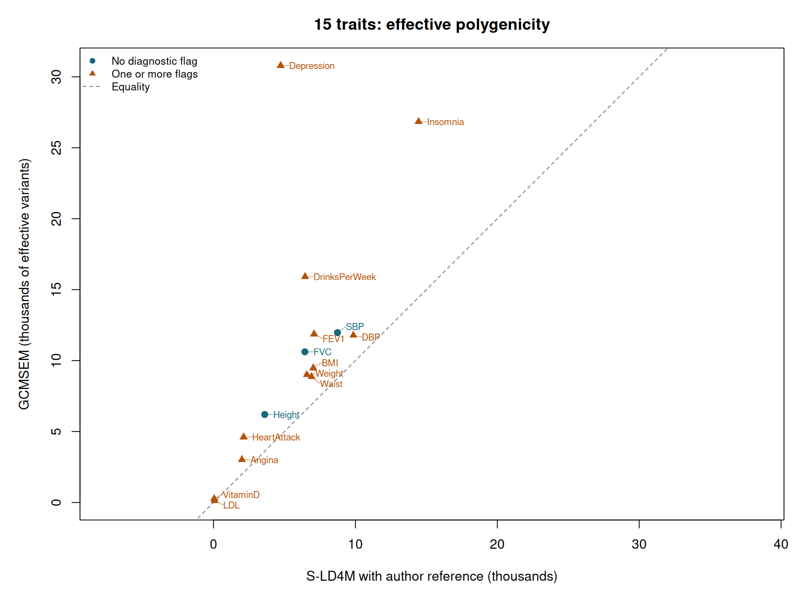
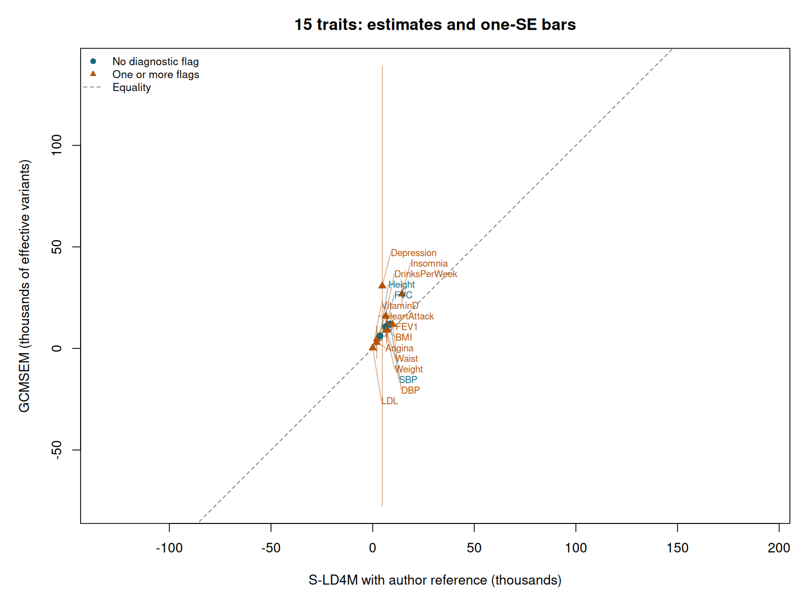

# Effective polygenicity: GCMSEM versus the author-released S-LD4M pipeline

We use the same 15 GWAS studies as the [genetic-correlation tutorial](Fifteen-trait-correlations.md), estimate effective polygenicity with each pipeline, and compare the results in R. S-LD4M receives the reference scores, annotations and regression weights distributed by its author. GCMSEM keeps its HapMap3 score workflow.

**Correction to the earlier comparison:** the earlier r = 0.9651 used GCMSEM scores and weights in both programs. That is a [matched-input diagnostic](Polygenicity-matched-input.md). This page runs S-LD4M with its own reference inputs and reports its native baseline-category result.

## 1. What the papers establish

O'Connor and colleagues introduced S-LD4M in [*Extreme Polygenicity of Complex Traits Is Explained by Negative Selection* (2019)](https://doi.org/10.1016/j.ajhg.2019.07.003). Their effective number measures the concentration of genetic variance and incorporates LD. Their [supplementary mathematical note](https://github.com/lukejoconnor/SLD4M/blob/dd947104cb3cb86bb8a651bf3b5abf5e5cbf46f3/polygenicity_supp.pdf) relates it to fourth moments and to a variance-weighted LD matrix.

The recent paper is O'Connor and Sella's [*Principled measures and estimates of trait polygenicity* (2026)](https://doi.org/10.1016/j.ajhg.2026.04.009), first posted in 2025. It develops several measures, including harmonic/effective and entropy polygenicity, and estimates them with Fourier Mixture Regression (FMR). The comparison below targets the effective measure. Second and fourth moments alone cannot determine entropy polygenicity or the literal number of nonzero effects. Running FMR would be a separate distributional analysis.

An effective count discounts very small contributions. For independent variants whose expected contributions to genetic variance are $v_i$, it is

```math
M_{e,\mathrm{LE}}=\frac{(\sum_i v_i)^2}{\sum_i v_i^2}.
```

If 1,000 variants contribute equally, this count is 1,000. If a few variants dominate, it is smaller. These are expected variance contributions under the random-effects model; this interpretation matters when connecting the count to moments of signed SNP effects.

## 2. Connect the definition to GCMSEM moments

GCMSEM reports a variance $v$ and an **excess fourth cumulant** $k_4$. The ordinary fourth central moment is $m_4=k_4+3v^2$, and excess kurtosis is $\gamma_2=k_4/v^2$.

For a zero-mean Gaussian variance mixture, the conversion without LD is

```math
M_{e,\mathrm{LE}}=\frac{3Mv^2}{m_4}=\frac{3M}{\gamma_2+3}.
```

Here $M$ counts **source variants** represented by the LD scores. Our release has 1,719,440 sources; the HM3 regression rows are a subset of tags. Substituting the number of tags would change the answer incorrectly.

The factor three follows from the Gaussian-mixture assumption. For example, a point-normal model with a nonzero fraction $\pi$ has $\gamma_2=3/\pi-3$, giving $M_e=M\pi$. For arbitrary non-Gaussian source effects, the same transformation is a Gaussian-mixture-equivalent count, and need not equal the number of causal variants. Negative fourth cumulants or implausible counts remain visible as diagnostic failures of that interpretation.

LD adds another term. Write $R$ for the genotype correlation matrix, $H=\sum_i v_i$, and $\Sigma=\mathrm{diag}(v_i)$. The variance-mixture target is

```math
M_e=\frac{H^2}{\mathrm{tr}\{(\Sigma^{1/2}R\Sigma^{1/2})^2\}}
=\frac{H^2}{\sum_{i,j}R_{ij}^2v_i v_j}.
```

Perfectly correlated variants contribute less independent information. Consequently the inverse-kurtosis count alone is insufficient for a comparison with S-LD4M.

### The calculation used here

Our implementation below is a derived comparison under the zero-mean, independent-source working model. For MAF bin $c$, let $M_c$, $v_c$ and $k_c$ denote its source count, estimated variance and fourth cumulant. Let $a_c$ be its mean marginal genetic variance. We calculate

```math
H=\sum_c M_c v_c,\qquad
D=\sum_c M_c k_c+3\sum_c M_c v_c a_c,\qquad
\widehat M_e=\frac{3H^2}{D}.
```

For the count without LD, replace $a_c$ by $v_c$. This keeps the extra kurtosis caused by different variances across bins. Averaging standardized bin kurtoses would lose that information.

We estimate $a_c$ using the mean second-order score among retained **HM3 tags in bin $c$**, multiplied by the vector of estimated source variances. Applying that mean to every source in the bin assumes that the tags represent the source LD distribution. The released archive does not contain second-order scores at every source SNP, so this is an additional approximation. This approximation belongs to the GCMSEM conversion. The S-LD4M analysis below uses its own complete reference, annotation model, weights and native reporting rule. Different reference SNP universes can therefore change the target as well as the estimate.

## 3. Understand the two inputs

| Setting | GCMSEM | S-LD4M in this tutorial |
|---|---|---|
| GWAS studies | The 15-study released panel | The same studies, downloaded from their original sources |
| Regression SNPs | 1,012,000 shared HM3 tags in the existing polygenicity analysis | Each GWAS intersected with the author's reference rsIDs |
| Reference | Released GCMSEM scores; 1,719,440 sources | `baselineLD.1kg.l2l4.mat`; 6,227,113 reference rows |
| Annotation model | Five disjoint MAF bins | All 75 supplied baseline-LD annotations |
| Second-moment weights | GCMSEM's fixed inverse-L2 weights | Supplied `EW2` values |
| Fourth-moment weights | GCMSEM's fixed inverse-L2 weights | Supplied `EW4` values |
| Jackknife | Existing 200 genomic deletion groups | The example's 100 equal-row blocks |
| Reported count | GCMSEM moment-to-count conversion above | Native `ma(1)` and `ma_se(1)` |

The [upstream README](https://github.com/lukejoconnor/SLD4M) links the reference archive. Its `example.m` specifies the full `baselineLD.1kg.l2l4.mat` file and the weights above. Appendix A of the 2019 paper describes inverse-L2 weighting for the second moment and inverse-L4 weighting for the fourth moment. Here we pass the author's stored weights directly.

This executes the author's released **1000 Genomes example configuration**. The 2019 paper's main empirical analysis used UK10K. Keep that distinction when comparing numbers with the paper. The archive also includes a smaller `baselineLD.1kg.common.l2l4.mat`; this tutorial uses the full file named by `example.m`.

The earlier GCMSEM setup removed a 60-row tail from 1,012,060 shared HM3 tags. We retain that existing GCMSEM analysis so the change here is the S-LD4M pipeline. S-LD4M now applies its own native tail handling separately to each GWAS; the counts are recorded in `provenance.json`.

## 4. Install and download the data

Start in the GCMSEM checkout and activate its Python environment as described on the [installation page](README.md#install). Install GNU Octave and the HDF5 reader:

```bash
sudo apt-get install octave libopenblas0-pthread
python -m pip install h5py pandas
mkdir -p external original-data/raw tutorial-results

git clone https://github.com/lukejoconnor/SLD4M.git external/SLD4M
git -C external/SLD4M checkout dd947104cb3cb86bb8a651bf3b5abf5e5cbf46f3

wget -O original-data/sld4m-1000g.zip \
  'https://www.dropbox.com/sh/iiyftw01gdpt6un/AACU7AmWK45RxTmDJvRkdKhIa?dl=1'

python tutorials/download_data.py --asset scores --asset panel --out tutorial-data
```

`SLD4M.m` remains unchanged. The execution script checks its SHA-256 against `d8ca72212d1618abfa0a9695d27fa49f45f851cd9641674809fe6a3ed4b5917a` before starting. The reference ZIP used here has SHA-256 `285219fc29a1305732b849a53a3372dfda4188d09a8b9ee89cf8267c990c7bfc`.

The ZIP contains the author's scores, annotations, weights, example script and height example. GCMSEM's [Zenodo release](https://zenodo.org/records/23977299) contains its derived scores and prepared GWAS panel. These numerical inputs remain externally hosted. Allow approximately 40 GB of free disk space for downloads and working files.

For S-LD4M, download the original GWAS files. For example, the height download is:

```bash
wget -O original-data/raw/50_irnt.gwas.imputed_v3.both_sexes.tsv.bgz \
  'https://broad-ukb-sumstats-us-east-1.s3.amazonaws.com/round2/additive-tsvs/50_irnt.gwas.imputed_v3.both_sexes.tsv.bgz'
```

Each Neale Lab table contains a genomic variant identifier, effect estimate, SE, `tstat`, sample size and a `low_confidence_variant` flag. `variants.tsv.bgz` supplies the variant-to-rsID mapping. The GSCAN drinks-per-week table contains rsIDs and a `STAT` column that is already chi-square. Its corrected 2019 file is used here.

The [source manifest](sld4m-source-gwas.tsv) lists all 15 GWAS files plus the mapping file, their public download URLs, sizes and checksums. This command downloads the remaining files, verifies every checksum and prepares chi-square inputs:

```bash
python tutorials/prepare_sld4m_gwas.py \
  --download --raw-dir original-data/raw \
  --out tutorial-results/raw-sld4m --workers 2
```

For Neale GWAS, the adapter squares `tstat` and excludes rows marked low confidence by the publisher. It verifies the entire variant-order hash before pairing with the rsID map. For GSCAN it reads `STAT` directly. Both routes require finite nonnegative chi-square statistics and valid rsIDs. There is no significance cutoff and large associations remain included.

Next, retain the original reference order and intersect each trait's rsIDs with that reference:

```bash
python tutorials/prepare_original_sld4m.py \
  --archive original-data/sld4m-1000g.zip \
  --raw-cache tutorial-results/raw-sld4m \
  --out tutorial-results/original-sld4m
```

This creates `ell2.f64`, `ell4.f64` and `annot.f64`, containing the original double-precision matrices in disk-readable form, and `reference_metadata.mat`, containing the original weights, rsIDs and annotation totals. Each `TRAIT.input.mat` contains the matched chi-square values and their original reference row indices. The accompanying JSON records input and matched row counts.

The three full matrices would need over 11 GB in memory. [SLD4MDiskMatrix.m](SLD4MDiskMatrix.m) reads the block requested by the original regression function. It preserves the numerical values and row order. An independent small-array test compares all 14 native outputs against an ordinary in-memory call; every output agreed exactly in the executed check.

## 5. Run both analyses from R

```r
library(GCMSEM)
source("tutorials/original_polygenicity.R")

result <- run_original_polygenicity(
  data_dir = "tutorial-data",
  gcmsem_out = "tutorial-results/gcmsem-polygenicity",
  native_dir = "tutorial-results/original-sld4m",
  out = "tutorial-results/original-polygenicity",
  sld4m_dir = "external/SLD4M",
  jobs = 1L
)
result
```

GCMSEM estimates each trait's moments through order four. S-LD4M then fits each original GWAS independently with its supplied annotations and weights. The R return value contains `comparison`, `annotations`, `moments`, `agreement` and `provenance`. The small on-disk tables also allow the analysis to be reopened later.

For a machine with more memory and cores, increase `jobs`. The executed S-LD4M run used Octave 8.4.0 with up to six concurrent traits and one BLAS thread each. Each trait has a separate log, such as `tutorial-results/original-sld4m/Height.log`.

The native call inside the wrapper is:

```matlab
[ma,ma_se,h,h_se,ma_enrich,ma_enrich_se,h_enrich,h_enrich_se,ma_jk,h_jk] = ...
    SLD4M(chisq,ell2,ell4,idx_ref,annot,EW2(idx_ref),EW4(idx_ref),100);
```

This preserves the default reporting annotations, baseline category, point-estimate convention and jackknife-SE calculation. We read `ma(1)` and `ma_se(1)` directly. The full signed annotation estimates are retained in `result$annotations`. The `h` output is left in its native chi-square input scale; it is not labelled a heritability estimate in the comparison.

### Executed output

```text
GCMSEM versus S-LD4M with the author's reference inputs
15 traits; S-LD4M: 75 annotations, 100 jackknife blocks
Native baseline-category estimates; separate SNP selection and weights
         trait   gcmsem  gcmsem_se     sld4m sld4m_se
 DrinksPerWeek 15910.96   4375.655  6454.315 3917.312
      VitaminD   273.40     99.255    50.712   26.578
           SBP 11971.02   2022.819  8737.174  630.430
      Insomnia 26836.94   6143.741 14450.802 1434.939
    Depression 30796.43 108314.673  4735.252 1497.308
           LDL   121.22    489.674    86.001   43.721
          FEV1 11874.57   1958.386  7086.678 1625.868
   HeartAttack  4615.55   6364.806  2125.719  582.328
        Angina  3017.08   8022.627  1999.420  632.905
        Height  6202.17    848.620  3612.232  229.116
        Weight  9002.62   3650.955  6578.993 1191.541
           BMI  9478.37   6276.382  7030.477 2026.151
           DBP 11779.27   2057.020  9855.071  678.169
           FVC 10620.47   1590.254  6439.964 1153.949
         Waist  8857.68   6477.507  6913.366 1906.715

Pearson r: 0.66682
RMSE: 8190.36 effective variants
Traits with diagnostic flags: 12 of 15
Inspect $comparison$flags and $annotations; signed estimates are retained.
```

## 6. Inspect the R objects and draw the scatterplot

```r
result$comparison
subset(result$annotations, trait == "Height")
result$moments$Height
result$comparison[, c("trait", "gcmsem_tags", "sld4m_matched_snps", "flags")]
saveRDS(result, "original-pipeline-polygenicity.rds")

plot(result, uncertainty = FALSE)
png("original-polygenicity-scatterplot.png", width = 1600, height = 1200, res = 160)
plot(result, uncertainty = FALSE)
dev.off()
```



Across all 15 traits, Pearson **r = 0.6668** and RMSE is **8,190.4 effective variants**. The earlier matched-input r = 0.9651 therefore substantially overstated the agreement obtained with independently configured reference pipelines.

For height, S-LD4M estimates 3,612 (SE 229), versus GCMSEM's 6,202 (SE 849). For drinks per week, the estimates are 6,454 (SE 3,917) and 15,911 (SE 4,376). Depression contributes a large discrepancy: 4,735 (SE 1,497) versus 30,796 (SE 108,315). Its very large GCMSEM uncertainty limits interpretation of that point. All 15 traits remain in the reported correlation.

Show the full one-SE uncertainty bars as well:

```r
plot(result, uncertainty = TRUE)
```



Orange triangles identify diagnostic flags. Negative estimates and intervals crossing zero remain visible. These ratios can be unstable when estimated fourth-moment denominators are near zero; symmetric SE bars are descriptive rather than calibrated confidence intervals. The two methods share GWAS studies, so their errors are correlated.

Their references and SNP universes differ. The scatterplot measures agreement between independently configured pipelines; its correlation alone cannot establish accuracy or equality of their population targets. GCMSEM additionally uses a Gaussian-mixture interpretation and HM3-tag LD averages in its moment-to-count transformation.

## 7. Reopen results and inspect provenance

```r
result <- read_original_polygenicity(
  "tutorial-results/original-polygenicity",
  "tutorial-results/gcmsem-polygenicity"
)
result$agreement
result$provenance$reference
result$provenance$traits
```

The [execution record](../docs/original-sld4m-validation.json) records software/reference hashes, every trait's SNP count and native output checksum. The earlier [matched-input diagnostic and simulation](Polygenicity-matched-input.md) remain available to examine the moment conversion under shared inputs and known LD. They answer a different question from the author-reference comparison above.
