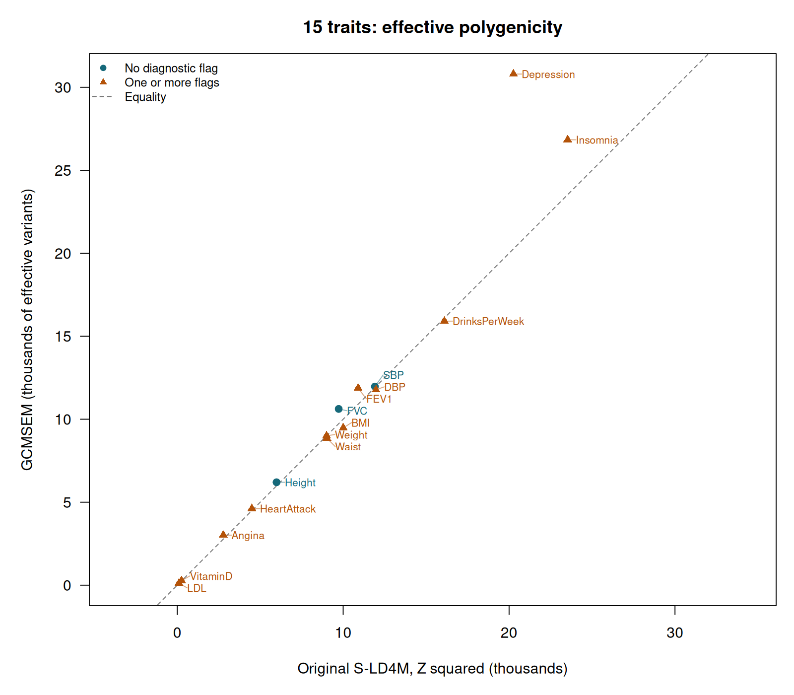
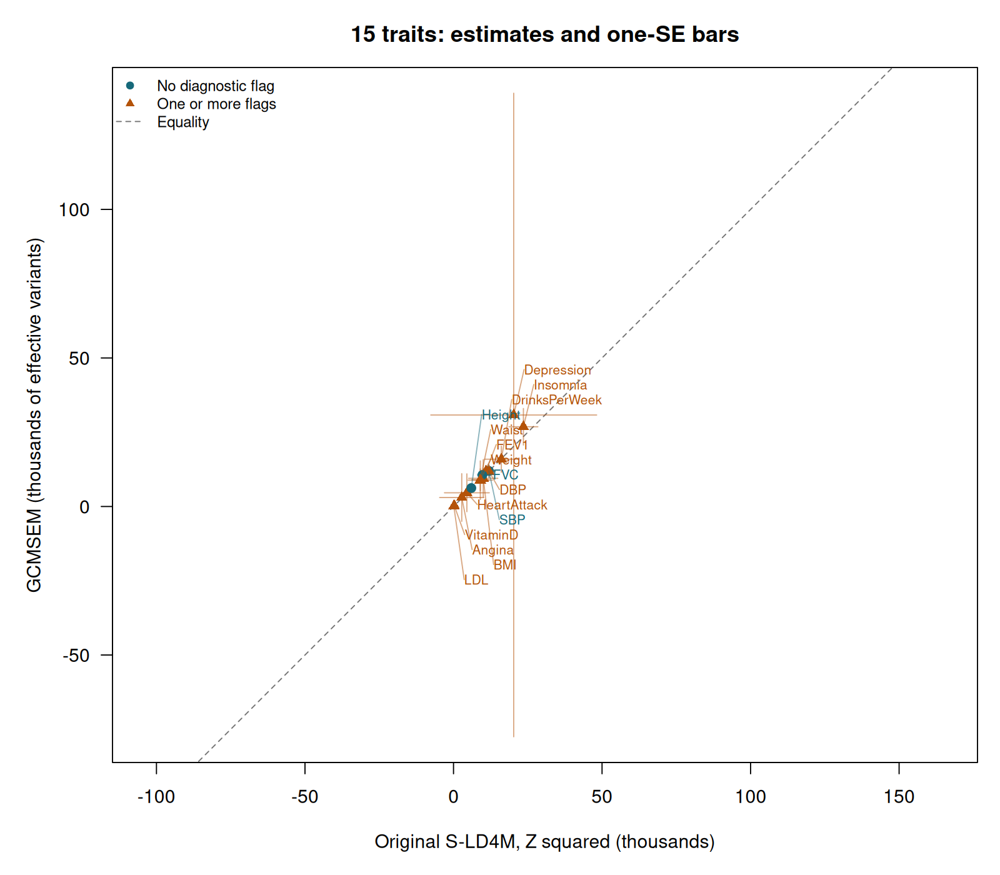
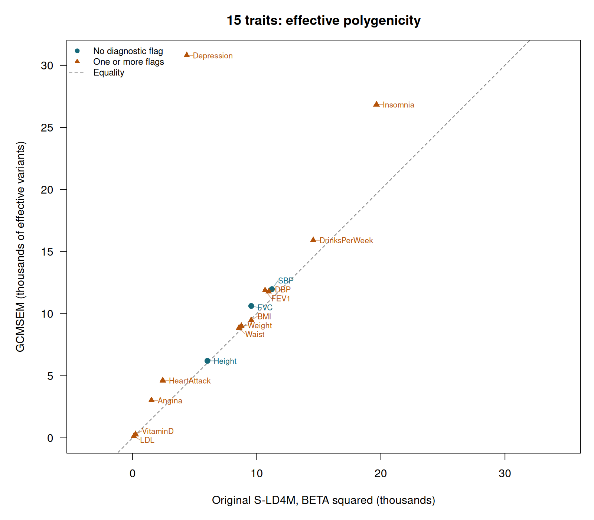

# From kurtosis to effective polygenicity: 15 traits compared with S-LD4M

This tutorial asks how widely genetic variance is distributed across variants. We estimate fourth moments with GCMSEM, convert them to an **effective polygenicity** measure, run Luke O'Connor's original S-LD4M software on the same inputs, and compare the 15 traits used in the [genetic-correlation tutorial](Fifteen-trait-correlations.md). You will keep the results in R and draw the comparison plot yourself.

## 1. What the papers establish

O'Connor and colleagues introduced S-LD4M in [*Extreme Polygenicity of Complex Traits Is Explained by Negative Selection* (2019)](https://doi.org/10.1016/j.ajhg.2019.07.003). Their effective number measures the concentration of genetic variance and incorporates LD. Their [supplementary mathematical note](https://github.com/lukejoconnor/SLD4M/blob/dd947104cb3cb86bb8a651bf3b5abf5e5cbf46f3/polygenicity_supp.pdf) relates it to fourth moments and to a variance-weighted LD matrix.

The recent paper is O'Connor and Sella's [*Principled measures and estimates of trait polygenicity* (2026)](https://doi.org/10.1016/j.ajhg.2026.04.009), first posted in 2025. It develops several measures, including harmonic/effective and entropy polygenicity, and estimates them with Fourier Mixture Regression (FMR). The comparison below targets the effective measure. Second and fourth moments alone cannot determine entropy polygenicity or the literal number of nonzero effects. Running FMR would be a separate distributional analysis.

An effective count discounts very small contributions. For independent variants whose expected contributions to genetic variance are $v_i$, it is

```math
M_{e,\mathrm{LE}}=\frac{(\sum_i v_i)^2}{\sum_i v_i^2}.
```

If 1,000 variants contribute equally, this count is 1,000. If a few variants dominate, it is smaller. These are expected variance contributions under the random-effects model; this interpretation matters when connecting the count to moments of signed SNP effects.

## 2. Connect the definition to GCMSEM moments

GCMSEM reports a variance $v$ and an **excess fourth cumulant** $k_4$. The ordinary fourth central moment is $m_4=k_4+3v^2$, and excess kurtosis is $\gamma_2=k_4/v^2$.

For a zero-mean Gaussian variance mixture, the conversion without LD is

```math
M_{e,\mathrm{LE}}=\frac{3Mv^2}{m_4}=\frac{3M}{\gamma_2+3}.
```

Here $M$ counts **source variants** represented by the LD scores. Our release has 1,719,440 sources; the HM3 regression rows are a subset of tags. Substituting the number of tags would change the answer incorrectly.

The factor three follows from the Gaussian-mixture assumption. For example, a point-normal model with a nonzero fraction $\pi$ has $\gamma_2=3/\pi-3$, giving $M_e=M\pi$. For arbitrary non-Gaussian source effects, the same transformation is a Gaussian-mixture-equivalent count, and need not equal the number of causal variants. Negative fourth cumulants or implausible counts remain visible as diagnostic failures of that interpretation.

LD adds another term. Write $R$ for the genotype correlation matrix, $H=\sum_i v_i$, and $\Sigma=\mathrm{diag}(v_i)$. The variance-mixture target is

```math
M_e=\frac{H^2}{\mathrm{tr}\{(\Sigma^{1/2}R\Sigma^{1/2})^2\}}
=\frac{H^2}{\sum_{i,j}R_{ij}^2v_i v_j}.
```

Perfectly correlated variants contribute less independent information. Consequently the inverse-kurtosis count alone is insufficient for a comparison with S-LD4M.

### The calculation used here

Our implementation below is a derived comparison under the zero-mean, independent-source working model. For MAF bin $c$, let $M_c$, $v_c$ and $k_c$ denote its source count, estimated variance and fourth cumulant. Let $a_c$ be its mean marginal genetic variance. We calculate

```math
H=\sum_c M_c v_c,\qquad
D=\sum_c M_c k_c+3\sum_c M_c v_c a_c,\qquad
\widehat M_e=\frac{3H^2}{D}.
```

For the count without LD, replace $a_c$ by $v_c$. This keeps the extra kurtosis caused by different variances across bins. Averaging standardized bin kurtoses would lose that information.

We estimate $a_c$ using the mean second-order score among retained **HM3 tags in bin $c$**, multiplied by the vector of estimated source variances. Applying that mean to every source in the bin assumes that the tags represent the source LD distribution. The released archive does not contain second-order scores at every source SNP, so this is an additional approximation. Both methods share the same inputs here; agreement assesses software behavior under that shared approximation. It does not independently validate the LD reference or reproduce the paper's original reference and GWAS datasets.

## 3. Install the software and download the inputs

Start in the GCMSEM checkout and activate its Python environment, as explained on the [installation page](README.md#install). Install GNU Octave to execute the original MATLAB function; this worked run used Octave 8.4.0. For example, on Ubuntu:

```bash
sudo apt-get install octave
python tutorials/download_data.py --asset scores --asset panel --out tutorial-data
mkdir -p external
git clone https://github.com/lukejoconnor/SLD4M.git external/SLD4M
git -C external/SLD4M checkout dd947104cb3cb86bb8a651bf3b5abf5e5cbf46f3
```

The downloads come from [Zenodo](https://zenodo.org/records/23977299). `scores/eur_hm3.scores.npz` contains signed LD-power scores and source counts for five MAF bins. `manifests/panel.tsv` identifies the 15 GWAS tables in `sumstats/`; each table contains SNP IDs, alleles, genotype-standardized BETA and SE values, and available QC/sample-size columns. No raw reference genotypes are needed for this comparison.

`SLD4M.m` is executed unchanged. Its pinned SHA-256 is `d8ca72212d1618abfa0a9695d27fa49f45f851cd9641674809fe6a3ed4b5917a`. The small [wrapper](run_sld4m.m) supplies inputs and captures native outputs. Converting the annotation input to a dense matrix makes its broadcasting work in Octave; it leaves the numerical input values unchanged.

## 4. Run the analysis and keep its results in R

From the checkout, start R in the activated environment:

```r
library(GCMSEM)
source("tutorials/polygenicity.R")

result <- run_polygenicity_example(
  data_dir = "tutorial-data",
  out = "tutorial-results/polygenicity",
  sld4m_dir = "external/SLD4M"
)
result
```

This runs three steps. [prepare_polygenicity.py](prepare_polygenicity.py) harmonizes all 15 GWAS files, retains their shared tags, and calls GCMSEM's `estimate_moments()` separately for each trait through order four. [run_sld4m.m](run_sld4m.m) runs the original S-LD4M regressions. [summarize_polygenicity.py](summarize_polygenicity.py) applies the count transformation to every genomic deletion and writes the comparison tables. The R helper returns those tables and the newly estimated moment objects as a list.

Both programs use the same GWAS rows, 1,012,000 tags, five source MAF bins, L2/L4 scores and fixed weights `1 / max(total_L2, 1)`. Harmonization initially retains 1,012,060 SNPs. The original S-LD4M code uses equal-size blocks and discards an incomplete final block; we explicitly remove the last 60 rows from **both** inputs. The 1,719,440 source counts remain unchanged.

The primary S-LD4M run uses its standard chi-square input, `Z^2 = (BETA / SE)^2`, whose sampling-noise variance is standardized. We also run its supported squared genotype-standardized effect input, `BETA^2`, as a sensitivity analysis. GCMSEM uses signed BETA and SNP-specific SE values, estimates a noise multiplier, and estimates source means. S-LD4M estimates a common noise intercept in the input scale.

A constant SE would make the two upstream input choices equivalent up to an irrelevant global scale. Here SEs have coefficients of variation of about 4–5%. Dividing each SNP by its own SE therefore changes its relative signal, and a common intercept on the BETA scale cannot absorb arbitrary SNP-specific noise. The two input choices can give different answers. We retain both results and describe the comparison as a diagnostic of these working assumptions.

GCMSEM keeps chromosome-respecting genomic deletion groups; S-LD4M keeps its original equal-row groups. Each method retains its own point-estimate and jackknife-SE conventions. We use the released GCMSEM scores and fixed weights for this matched-input experiment; this does not recreate the 2019 paper's complete reference pipeline.

For each MAF bin the native function returns $H_c$ and $M_{e,c}$. We combine them **inside each deletion** as

```math
M_{e,\mathrm{total}}=\frac{(\sum_c H_c)^2}{\sum_c H_c^2/M_{e,c}}.
```

This source-weighted aggregation is in our comparison code. The native per-bin results are also retained in `result$strata`. The total shown below is this derived total, rather than S-LD4M's optional pooled reporting column.

The executed run prints:

```text
GCMSEM and original S-LD4M: effective polygenicity
15 traits; 1,012,000 common HM3 tags
Source-weighted MAF-bin aggregation; HM3 proxy for source LD averages
S-LD4M input: Z squared
         trait  gcmsem gcmsem_se   sld4m sld4m_se
 DrinksPerWeek 15911.0   4375.65 16098.6   5605.5
      VitaminD   273.4     99.25   260.1    245.9
           SBP 11971.0   2022.82 11912.6   2019.4
      Insomnia 26836.9   6143.74 23528.5   4865.9
    Depression 30796.4 108314.67 20264.3  27914.8
           LDL   121.2    489.67   100.7    513.0
          FEV1 11874.6   1958.39 10898.6   1795.0
   HeartAttack  4615.5   6364.81  4495.4   7539.8
        Angina  3017.1   8022.63  2772.5   7439.0
        Height  6202.2    848.62  5985.0    971.9
        Weight  9002.6   3650.95  8999.8   2857.3
           BMI  9478.4   6276.38 10005.0   4906.3
           DBP 11779.3   2057.02 11975.1   2074.4
           FVC 10620.5   1590.25  9730.6   1704.3
         Waist  8857.7   6477.51  9019.6   4088.9

Pearson r: 0.9651
RMSE: 2876.6 effective variants
Traits with one or more diagnostic flags: 12 of 15
Inspect $comparison$flags and $strata; signed estimates are retained.
```

The `sld4m` columns refer to the primary Z-squared run. `sld4m_beta` and `sld4m_beta_se` retain the squared-effect sensitivity results. All 15 traits remain in the table, including flagged estimates.

The log in `tutorial-results/polygenicity/preparation.log` records harmonization, source counts, the noise estimates and progress through the 200 genomic deletions. The generated `.mat`, `.npz` and moment files are working outputs in your chosen directory. The tutorial's inputs are externally hosted, and the large intermediates are not committed to GitHub.

You can also run each computational step from a terminal:

```bash
python tutorials/prepare_polygenicity.py --data-dir tutorial-data --out tutorial-results/polygenicity

octave --no-gui --quiet --eval "addpath('tutorials'); run_sld4m('tutorial-results/polygenicity/sld4m_input.mat','external/SLD4M','tutorial-results/polygenicity/sld4m.mat','beta');"

octave --no-gui --quiet --eval "addpath('tutorials'); run_sld4m('tutorial-results/polygenicity/sld4m_input.mat','external/SLD4M','tutorial-results/polygenicity/sld4m_zscore.mat','zscore');"

python tutorials/summarize_polygenicity.py --out tutorial-results/polygenicity --sld4m external/SLD4M
```

Choose a new output directory for a fresh run. To reopen the analysis you have just computed:

```r
result <- read_polygenicity_comparison("tutorial-results/polygenicity")
result$moments$Height
result$comparison
result$strata
saveRDS(result, "height-and-panel-polygenicity.rds")
```

## 5. Inspect kurtosis and the count without LD

The ordinary moment object is available for each trait:

```r
height <- result$moments$Height
height$moments[height$moments$order %in% c(2, 4), ]
independent_effective_count(height, "Height")
```

The latter helper transforms the pooled variance and fourth cumulant and uses their full 2 × 2 sampling covariance for a delta-method SE. The comparison table instead recomputes the transformation from conditional source-bin cumulants in every deletion. These conventions can differ slightly because source means are estimated and the transformation is nonlinear. The `gcmsem_no_ld` column is the zero-mean mixture count without LD; `gcmsem` is the LD-adjusted approximation used in the scatterplot.

## 6. Draw the 15-trait scatterplot

Every trait is retained. Orange triangles identify one or more diagnostic flags; the full reason is stored in the table.

```r
plot(result, uncertainty = FALSE)

png("polygenicity-scatterplot.png", width = 1600, height = 1200, res = 160)
plot(result, uncertainty = FALSE)
dev.off()

# The full one-SE view is useful for seeing unstable ratio estimates.
plot(result, uncertainty = TRUE)
result$comparison[, c("trait", "gcmsem", "gcmsem_se", "sld4m", "sld4m_se", "flags")]
```



Across all 15 traits, Pearson **r = 0.9651** and RMSE is **2,876.6 effective variants**. For height, GCMSEM gives 6,202 (SE 849) and S-LD4M gives 5,985 (SE 972). For SBP the estimates are 11,971 (SE 2,023) and 11,913 (SE 2,019).

Twelve traits have at least one diagnostic flag. Depression illustrates why the scatterplot alone is insufficient: its GCMSEM estimate is 30,796 with SE 108,315, versus 20,264 with SE 27,915 from S-LD4M. LDL, heart attack and angina also have substantial uncertainty. These estimates do not support precise rankings of those traits. The following view includes the full one-SE bars, even where they extend below zero.



The denominator $D$ is estimated from fourth moments and can be noisy. A small denominator produces a large count; if it crosses zero across deletions, ordinary ratio SEs can become enormous. Such uncertainty is information about the limits of the analysis. The code retains signed estimates and flags nonpositive bin variances, negative fourth cumulants, nonpositive S-LD4M bin counts and denominators not separated from zero. The one-SE bars are descriptive uncertainty summaries, not symmetric confidence intervals or a paired test between methods. Both estimates share GWAS and reference information, so their errors are correlated.

### Sensitivity to squared-effect input

```r
plot(result, uncertainty = FALSE, input = "beta")
result$comparison[, c("trait", "sld4m_beta", "sld4m_beta_se", "flags_beta")]
result$agreement$beta_input_pearson
# [1] 0.6210247
```



Here Pearson **r = 0.6210** and RMSE is **7,134.1 effective variants**. Depression's upstream estimate changes to 4,358 (SE 2,740); GCMSEM is unchanged. Standardizing the noise improves the empirical agreement, but this result alone cannot establish which estimator is closer to biological truth. The source/tag approximation and within-bin model assumptions are shared. The per-bin `sld4m_beta_fourth_coefficient` columns use the BETA run so they remain in the same effect units as GCMSEM cumulants. The primary upstream denominators instead use the Z input scale; their numerical magnitudes should not be compared directly with GCMSEM denominators.

## 7. Check the mapping when the LD and truth are known

A separate reproducible check generates 84,111 variants in 1,200 independent LD blocks with lengths from 20 to 120. Within each block, signed AR(1) correlations vary in strength. Two Gaussian-mixture architectures have 2% and 20% nonzero source variances; GWAS noise uses a sample size of 200,000. Every source is also a tag, so the source/tag approximation disappears. The true effective count is calculated directly from the generating variance vector and LD matrix.

```bash
python tutorials/simulate_polygenicity.py --out tutorial-results/polygenicity-simulation

octave --no-gui --quiet --eval "addpath('tutorials'); run_sld4m('tutorial-results/polygenicity-simulation/sld4m_input.mat','external/SLD4M','tutorial-results/polygenicity-simulation/sld4m.mat');"

python tutorials/summarize_polygenicity.py --out tutorial-results/polygenicity-simulation --sld4m external/SLD4M
```

| Architecture | True LD-adjusted count | GCMSEM estimate (SE) | Original S-LD4M estimate (SE) |
|---|---:|---:|---:|
| 2% nonzero source variances | 1,627.6 | 1,383.7 (271.8) | 1,309.6 (266.5) |
| 20% nonzero source variances | 13,099.9 | 12,956.1 (860.2) | 13,384.7 (940.6) |

The constant simulated SE makes BETA-squared and Z-squared input equivalent up to scale. Both methods are within approximately 1.2 reported SEs of the generating effective counts.

This is one fixed-seed check of two architectures, not a coverage study. Separate unit tests verify the point-normal normalization, collapse to one effective variant under perfect LD, variance heterogeneity across strata, effect-scale invariance and retention of signed estimates. We also checked the zero-LD transformation against the 2026 paper's original `compute_polygenicity(..., 'effective')` helper on a known Gaussian mixture. To reproduce that algebraic check:

```bash
git clone https://github.com/lukejoconnor/polygenicity_scripts.git external/polygenicity_scripts
git -C external/polygenicity_scripts checkout 393292076b3fdabb218fa1ba8db386b0d2d5b1b6
octave --no-gui --quiet --eval "addpath('external/polygenicity_scripts/MATLAB/helpers'); disp(compute_polygenicity([.0001,.0003],[1,6]/7,.7,'effective'));"
```

It returns 2,578.9474, matching `0.7 / sum((c(1, 6) / 7) * c(0.0001, 0.0003))` in R. Here the helper's mixture weights represent fractions of heritability, as in the paper. This checks the transformation; we have not fitted FMR to these 15 GWAS datasets.

## 8. What the comparison supports

The fourth-moment machinery can supply an effective-polygenicity diagnostic. Its interpretation requires a declared source universe, a variance-mixture model and an LD calculation. The current empirical comparison also assumes representative HM3 tags within MAF bins and conditions uncertainty on the supplied scores. The released L4 scores use finite-reference plug-in fourth powers; their reference-sampling uncertainty is not included. Rare variants outside the source universe, functional or LD-related effect heterogeneity within bins, and noisy fourth moments can change the answer.

The empirical plot is therefore a validation experiment with visible limitations. It should guide further investigation of discrepancies and uncertainty before these counts are used as definitive biological rankings. Latent-source moments from an SEM require the additional SEM identification assumptions; this tutorial uses the observed traits' genomic moments throughout.

The [execution record](../docs/polygenicity-validation.json) pins software revisions, source counts, input/output hashes and the checks performed. The [R transcript](output/polygenicity-comparison.txt) preserves the printed panel results.
