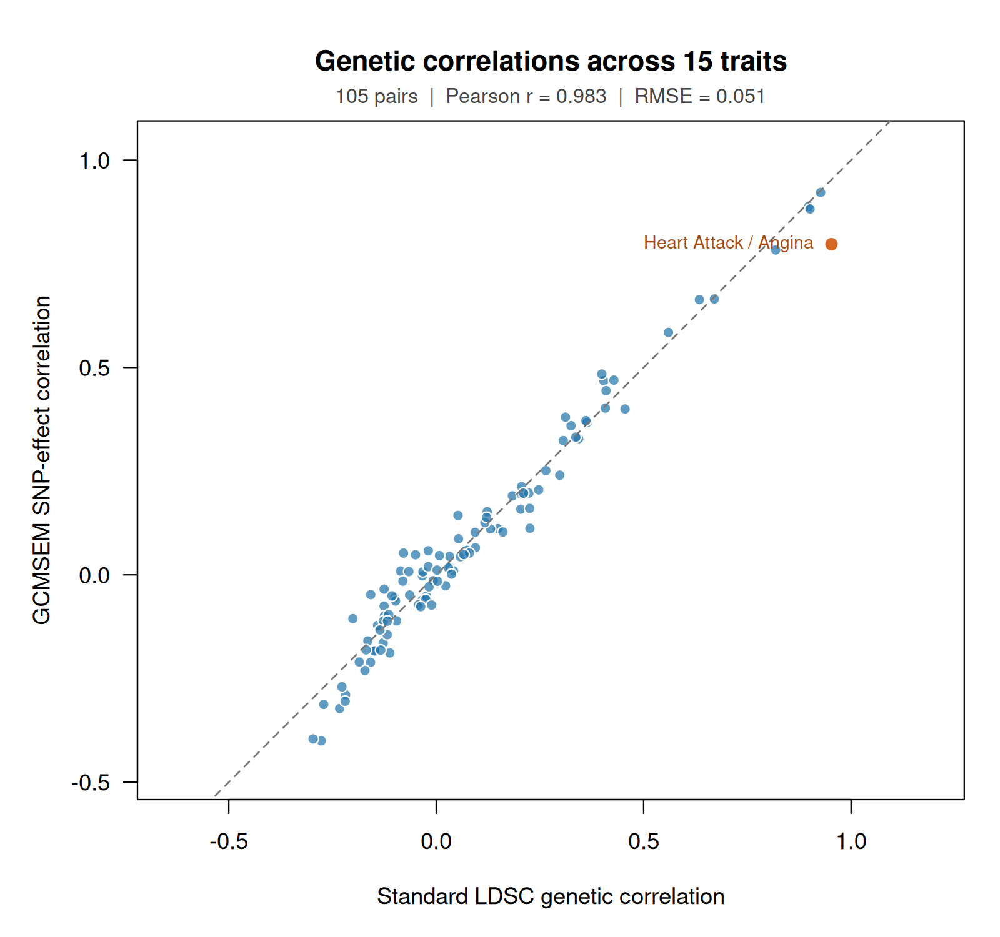

# GCMSEM empirical tutorials

These worked examples take real GWAS summary statistics through moment estimation and model fitting in R. You keep the moments, covariance and correlation matrices, SEM fits, parameter tables and logs as ordinary R objects. The tutorials explain each input file, show the R commands, and include the console output you should see.

The bulk numerical inputs and result bundles are distributed separately from GitHub. The repository contains the scripts, documentation and tutorial figures. Score archives contain derived signed LD-power scores at HapMap3 regression SNPs; reference genotypes and the original HapMap3 dataset are excluded.

| Tutorial | What it runs |
|---|---|
| [Height/weight and BMI/SBP](Causal-examples.md) | Download and inspect GWAS tables, estimate moments, fit SEMs, and inspect parameters and diagnostics in R. Includes original-source `wget` commands and complete [height/weight](height_weight.R) and [BMI/SBP](bmi_sbp.R) scripts. |
| [Fifteen-trait correlations](Fifteen-trait-correlations.md) | Read both 15 × 15 matrices into R, compare all 105 pairs and draw the scatterplot with [correlations.R](correlations.R). LDSC uses unmodified stock software and its published standard reference and weights. |
| [Data and scores](Data-and-scores.md) | Reference definition, download integrity, source reconstruction and reuse limits |
| [Rights and attribution](DATA_RIGHTS.md) | Original GWAS policies and reference attribution |

## Install

Use Python 3.10 or newer, R 4.1 or newer and a C++ compiler. Run these commands in a terminal:

```bash
git clone https://github.com/MichelNivard/GCMSEM.git
cd GCMSEM
python3 -m venv .venv
source .venv/bin/activate
python -m pip install .
Rscript -e 'install.packages("jsonlite", repos="https://cloud.r-project.org")'
R CMD INSTALL .
```

This installs R package version 0.2.0 and Python engine version 0.1.0. `estimate_moments()` uses the Python engine and requires `jsonlite`. Keep the environment activated when starting R. If starting R elsewhere, provide the environment's executable through the function's `python` argument.

The [small example in the main README](../README.md#run-a-complete-small-example) generates three synthetic GWAS tables and scores locally. Run it immediately after installation to try `estimate_moments()` → `standardize_moments()` → `gcmsem()` without waiting for the empirical data release.

The standard LDSC comparison uses a separate Python 2.7 environment for original `bulik/ldsc`. Follow [Standard-LDSC-environment.md](Standard-LDSC-environment.md), then the [15-trait tutorial](Fifteen-trait-correlations.md). GCMSEM uses the Python 3 environment above.

## Data release status

The numerical release is prepared for Zenodo, and account authorization is complete. **The upload is incomplete; the record is not yet published.** Zenodo has reserved DOI `10.5281/zenodo.23977299` for the draft. This is not yet a working public data release. The checked-in [manifest](data_manifest.json) records exact archive sizes and SHA-256 checksums. Once publication is verified, its `zenodo_record_id` will be set to the actual published record.

After publication, run from the repository root:

```bash
python tutorials/download_data.py --out tutorial-data
```

If using a supplied, already-downloaded archive before deposition, extract it into `tutorial-data/`, preserving the paths in the archive. The examples then run locally without Zenodo credentials. A replacement host must serve the same pinned bytes; updates require a new data manifest.

## Work interactively in R

Once the data are extracted, follow either worked tutorial line by line. You can also source its complete script and keep all of its results in your R session:

```r
library(GCMSEM)
source("tutorials/height_weight.R")
hw <- height_weight_example(data_dir = "tutorial-data")

hw$moments
summary(hw$forward)
parameter_estimates(hw$forward)
hw$paths
```

The script first calls `estimate_moments()`, then `standardize_moments()`, and finally `gcmsem()` for each specified model. The same objects are available when running the commands individually in the [worked example](Causal-examples.md).

| Expression | Result |
|---|---|
| `hw$moments$S`, `hw$moments$S_SE` | SNP-effect covariance and SE matrices |
| `hw$moments$R`, `hw$moments$R_SE` | Genetic-correlation matrix and delta-method SEs using the full sampling covariance |
| `hw$moments$V` | Joint sampling covariance of all estimated cumulants |
| `hw$moments$log` | Moment-estimation log |
| `coef(hw$forward)`, `vcov(hw$forward)` | SEM coefficients and their parameter sampling covariance |
| `hw$forward$diagnostics`, `hw$forward$log` | Fit checks and retained fitting log |

Printing shows a readable overview. `s <- summary(hw$forward)` creates a structured summary without printing; type `s` to display it. Covariance and correlation matrices remain complete for any number of traits, while the default console preview shows six traits at most.

Save results when you want to keep files:

```r
saveRDS(hw, "height-weight-analysis.rds")
export_gcmsem(hw$moments, "results/height-weight-moments")
export_gcmsem(hw$forward, "results/height-weight-fit")
```

`estimate_moments()` and `gcmsem()` also accept `write.to.tsv = TRUE, out = "results/my-analysis"` and still return their R objects. Exports require `overwrite = TRUE` to replace existing files. The [15-trait tutorial](Fifteen-trait-correlations.md) similarly keeps both methods' matrices and the comparison table in R, then uses `plot(comparison)` to draw the figure:



## What is reproduced

The scores use a European 503-person reference, GRCh37 coordinates, five disjoint MAF strata and a 1 Mb rolling LD window. The 1,074,062 regression tags and 1,719,440 source variants have different roles: filtering a GWAS tag does not change source counts. Scores and effects use the same minor-allele orientation; signed odd powers are retained. GCMSEM's HM3 SNP selection is retained for both methods' inputs; standard LDSC then applies its ordinary munging and pair-specific QC.

The [execution report](Execution-report.md) records the completed real-data runs, all six SEM fits, all 105 standard LDSC pairs and software validation.

The SEM examples use `estimate_moments()` with the normal GWAS harmonizer. The archived 15-trait calculation uses a pre-harmonized array to reproduce its exact common panel. Because original GWAS EAF is unavailable in the prepared cache, the normal harmonizer drops three palindromic tags. The correlation tutorial explains both input routes and their SNP counts.

The higher-order analyses remain research examples. Formal sandwich SEs are reported when computable, including for inadmissible source moments. Convergence, identification, admissibility and inference flags accompany every fit. The earlier simulation validation showed limited fourth-order interval coverage; these empirical tutorials do not establish causal identification or resolve that calibration limitation.

## Wiki availability

The repository is public and its [GitHub Wiki](https://github.com/MichelNivard/GCMSEM/wiki) is enabled. These linked Markdown pages provide the versioned tutorial source. The Wiki is readable by everyone; editing is restricted to repository collaborators.
